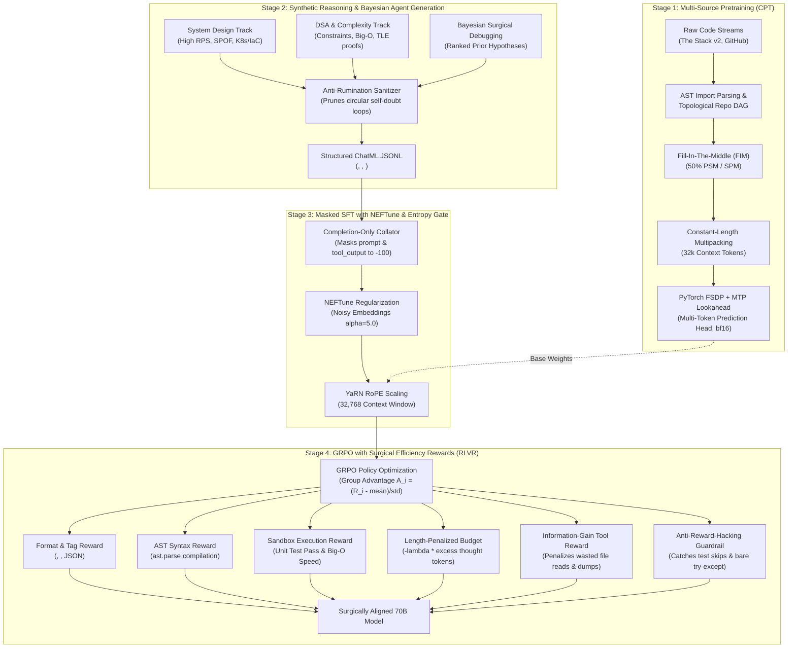

# 🍫 Cadbury-Chocolate 70B — Distributed Code Reasoning & Agentic LLM Pipeline

A complete, production-grade training architecture, synthetic reasoning pipeline, and execution-verified reinforcement learning framework for a **70-Billion parameter code-generation & reasoning language model**. 

Modeled after modern frontier architectures: **DeepSeek-R1 / DeepSeek-V3**, **Claude 3.5 Sonnet / Opus**, and **StarCoder2**.

---

## 🏗️ 4-Stage End-to-End Training Architecture



---

## 🏛️ Model Architecture & Mathematics (70B)

| Hyperparameter | Value | Architectural Purpose |
| :--- | :--- | :--- |
| **Active Parameters** | **~70.55 Billion** | Deep reasoning across system architecture, algorithms, and 80+ languages |
| **Layers (`n_layer`)** | **80** | Deep hierarchical abstraction of program logic, dataflow, and syntax |
| **Hidden Dimension (`d_model`)** | **8,192** | Wide residual stream representation space |
| **Intermediate Size (`d_ff`)** | **28,672** | SwiGLU feed-forward layer (~3.5× hidden dimension) |
| **Attention Heads (`n_head`)** | **64** | Multi-head attention (Query dimension = 128) |
| **KV Heads (`num_kv_heads`)** | **8** | **Grouped-Query Attention (GQA)** (8:1 ratio) to save KV cache |
| **Context Window** | **32,768 tokens** | Full repository context via **YaRN RoPE Scaling** (factor 4.0) |
| **Vocabulary Size** | **128,270** | Byte-Level BPE with specialized `<think>`, `<hypothesis>`, `<tool_call>`, FIM tags |
| **Position Embeddings** | **RoPE ($\theta = 500,000$)** | High base frequency for long-context extrapolation |
| **Attention Kernel** | **FlashAttention-2** | Hardware-fused $O(N)$ memory attention |

---

## 🧠 Adaptive Compute & Surgical Agentic Localization

Cadbury-Chocolate introduces two critical architectural innovations designed to eliminate the two most common failure modes of reasoning models: **Overthinking on simple queries** and **Context Pollution during debugging**.

### 1. Bayesian Hypothesis Localization (`data_synthesis/schemas.py`)
Junior coding models exhibit "blind browsing" — running `ls -R` or opening dozens of files when presented with a bug. Cadbury enforces a **Bayesian prior formulation**:
* When faced with a multi-tier or cross-stack error (e.g. database to API to frontend), the model **must** calculate a ranked probability distribution across candidate layers inside `<hypothesis>` *before* calling any tool:
  $$P(H_1 = \text{DB Migration}) = 0.65, \quad P(H_2 = \text{Serializer}) = 0.25, \quad P(H_3 = \text{UI State}) = 0.10$$
* **Surgical Line Slicing:** Reading whole files is forbidden. Trajectories use `read_file` with explicit `start_line` and `end_line` slices (e.g. lines 35–55) to maximize Context Signal-to-Noise Ratio (SNR).

### 2. Anti-Rumination & Entropy-Aware Early Exit (`training/adaptive_compute.py`)
* **Shannon Entropy Monitoring:** During generation of `<think>`, the model computes token prediction entropy:
  $$H(p) = -\sum_{v \in V} p(v) \log_2 p(v)$$
* **Early Exit Trigger:** When the moving average entropy over a 15-token window is below $\tau = 0.45$ (indicating high certainty / straightforward task), the `EntropyReasoningGate` terminates `<think>` immediately with `</think>\n\n`, answering directly without wasting compute.
* **Synthetic Filter:** The dataset generator automatically sanitizes repetitive self-doubt loops (*"Wait, let me rethink"*, *"Actually, maybe not"*).

### 3. Multi-Token Prediction (MTP) Lookahead
* Implements DeepSeek-V3 style **Multi-Token Prediction**:
  $$\mathcal{L}_{\text{total}} = \mathcal{L}_{\text{main}} + \lambda_{\text{MTP}} \sum_{k=1}^2 \mathcal{L}_{\text{MTP}_k}$$
* Auxiliary prediction heads train the model to anticipate $t+2$ and $t+3$ tokens concurrently, improving structural code planning.

### 4. Surgical Reinforcement Learning Rewards (`training/rl_grpo_verifier.py`)
In post-SFT GRPO training, policy updates are driven by 6 verifiable reward heads:
1. **Length-Penalized Thinking Budget:**
   $$R_{\text{length}} = -\lambda \cdot \max(0, \text{Tokens}_{\text{think}} - B_{\text{optimal}})$$
   Among rollouts that pass unit tests, assigning the highest reward to the most concise thought process teaches dynamic effort scaling.
2. **Information-Gain Tool Reward:**
   * Step penalty ($-0.02$) per tool call to prevent tool churn.
   * Compares files inspected via `read_file` against files modified in the final git patch. Reading $>2$ irrelevant files incurs a $-0.15$ penalty per wasted read. Blind directory dumps (`ls -R`, `find .`) receive a $-0.5$ penalty. Surgical 1-hop localization receives a $+0.5$ bonus.
3. **Anti-Reward-Hacking Guardrail:**
   * Penalizes test-skipping cheats (`@pytest.mark.skip`, `skipTest`), bare `try...except: pass`, and hardcoded return values with a severe $-3.0$ penalty.

---

## ⚡ Cluster Hardware & VRAM Memory Math

* **Model Weights (in bfloat16):** $70.55\text{B} \times 2\text{ bytes} \approx \mathbf{141.1\text{ GB}}$
* **Gradients (in bfloat16):** $70.55\text{B} \times 2\text{ bytes} \approx \mathbf{141.1\text{ GB}}$
* **AdamW Optimizer States (fp32 master weights, momentum, variance):** $70.55\text{B} \times 8\text{ bytes} \approx \mathbf{564.4\text{ GB}}$
* **Total Static Pretraining Footprint:** $\approx \mathbf{846.6\text{ GB}}$

### Cluster Feasibility Matrix

| Setup | Hardware | Method | Memory per GPU | Target Phase |
| :--- | :--- | :--- | :--- | :--- |
| **Multi-Node Cluster** | **32x H100 (80GB)** (4 Nodes) | PyTorch FSDP FULL_SHARD | $\approx 26.5\text{ GB}$ static + activations | Stage 1 CPT & Stage 3 SFT |
| **Mid-Scale Cluster** | **16x A100 (80GB)** (2 Nodes) | FSDP + Act. Checkpointing | $\approx 53.0\text{ GB}$ static + activations | Stage 3 SFT & Stage 4 GRPO |
| **Single GPU Developer** | **1x A100 / H100 (80GB)** | 4-bit NF4 QLoRA + Paged AdamW | $\approx 45.0\text{ GB}$ total VRAM | Single-Node Fine-Tuning |

---

## 📁 Repository Structure

```text
cadbury-chocolate/
├── configs/
│   ├── model_70b_config.yaml     # 70.55B architecture + YaRN RoPE (32k) + MTP/RL configs
│   ├── fsdp_config.yaml          # PyTorch FSDP FULL_SHARD cluster setup
│   ├── deepspeed_zero3.json      # DeepSpeed ZeRO-3 offload configuration
│   └── qlora_config.yaml         # 4-bit parameter-efficient fine-tuning config
├── data_collection/
│   ├── stream_hf_code.py         # Disk-free streaming ingestion from Hugging Face
│   ├── github_crawler.py         # Multi-language Git repository harvester
│   └── fim_formatter.py          # Fill-In-The-Middle (PSM/SPM) transformations
├── data_processing/
│   ├── syntax_validator.py       # AST-based syntax checking (Python, JS, C, Rust)
│   ├── secret_scrubber.py        # PII, API tokens, and cryptographic key sanitizer
│   ├── minhash_dedup.py          # MinHash LSH near-deduplication (Jaccard similarity)
│   ├── quality_filter.py         # Line-length, entropy, and autogen heuristics
│   └── repo_packer_fim.py        # Topological AST import sorting & repo multipacking
├── data_synthesis/
│   ├── schemas.py                # BayesianHypothesis, ChatML & XML schemas (<hypothesis>, <think>)
│   └── generate_reasoning_traces.py # Surgical System Design, DSA, & Anti-Rumination ReAct generator
├── tokenization/
│   ├── train_code_tokenizer.py   # Byte-Level BPE with special tags (<think>, <hypothesis>, <tool_call>)
│   └── sequence_packer.py        # Zero-waste constant-length multipacking (32k ctx)
├── training/
│   ├── adaptive_compute.py       # Multi-Token Prediction (MTP) & Entropy Early-Exit Gate
│   ├── pretrain_fsdp.py          # Multi-node FSDP pretrainer with FlashAttention-2
│   ├── sft_reasoning_trainer.py  # Completion-Only Masked SFT with NEFTune regularizer
│   ├── rl_grpo_verifier.py       # GRPO with 6 verifiable rewards (length, info-gain, anti-hacking)
│   ├── train_qlora.py            # 4-bit QLoRA fine-tuning for 70B on 1x 80GB GPU
│   └── launch_slurm.sh           # HPC SLURM submission script (4 nodes x 8 GPUs)
├── utils/
│   ├── logger.py                 # Rank-aware distributed cluster logger
│   └── memory_tracker.py         # VRAM allocation and peak usage profiler
├── requirements.txt              # Production cluster dependencies
└── README.md
```

---

## 🚀 Cluster Execution Commands

### 1. Generate Surgical Reasoning Trajectories
```bash
python data_synthesis/generate_reasoning_traces.py
```

### 2. Pack Repositories with Topological Sorting & FIM
```bash
python data_processing/repo_packer_fim.py
```

### 3. Launch Masked SFT with NEFTune across Multi-Node Cluster
```bash
torchrun \
    --nnodes=4 \
    --nproc_per_node=8 \
    --rdzv_id=cadbury_sft \
    --rdzv_backend=c10d \
    --rdzv_endpoint=master-node:29500 \
    training/sft_reasoning_trainer.py \
    --model-path "checkpoints/cadbury-70b" \
    --data-file "data/processed/sft_reasoning/sample_reasoning_data.jsonl" \
    --neftune-alpha 5.0 \
    --max-seq-len 32768
```

### 4. Run GRPO Policy Optimization with Length & Info-Gain Rewards
```bash
torchrun --nproc_per_node=8 training/rl_grpo_verifier.py
```

---

## 📜 License
MIT License. Built for advanced code reasoning research, autonomous software engineering agents, and cluster deployment.
