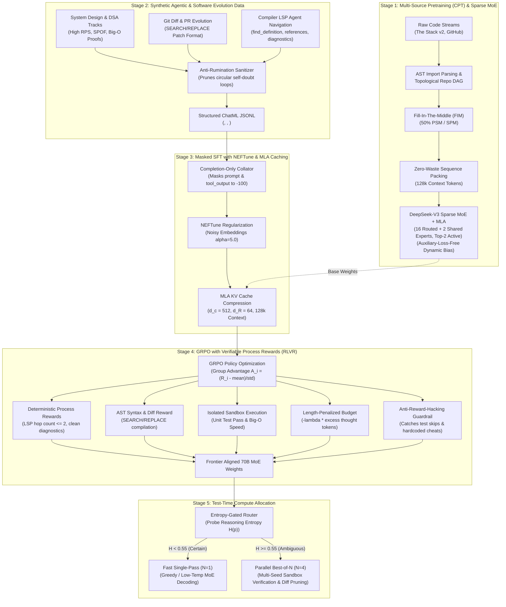
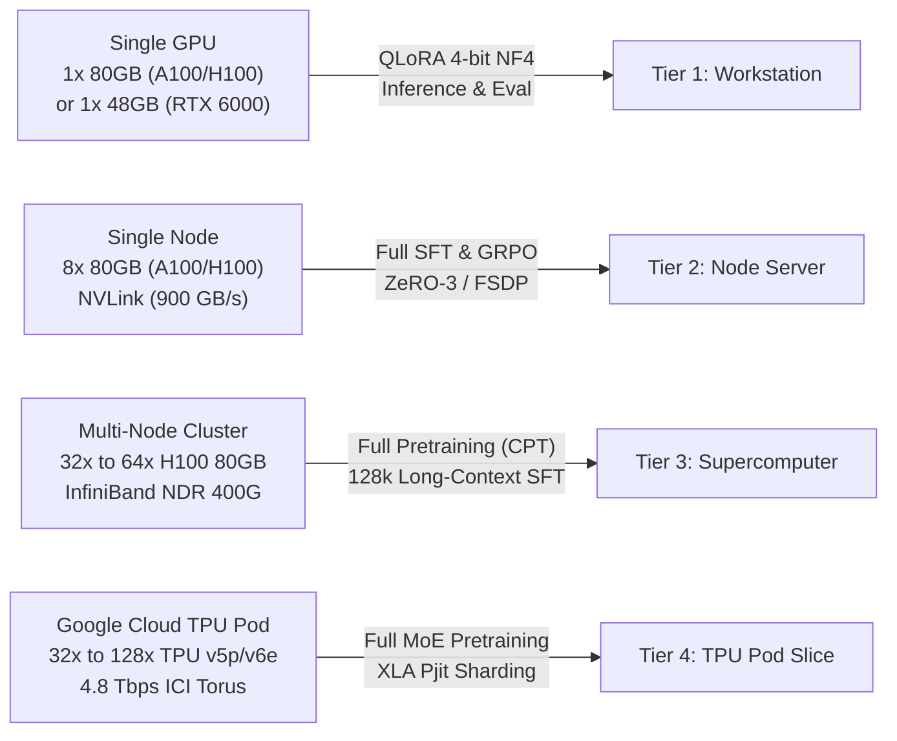
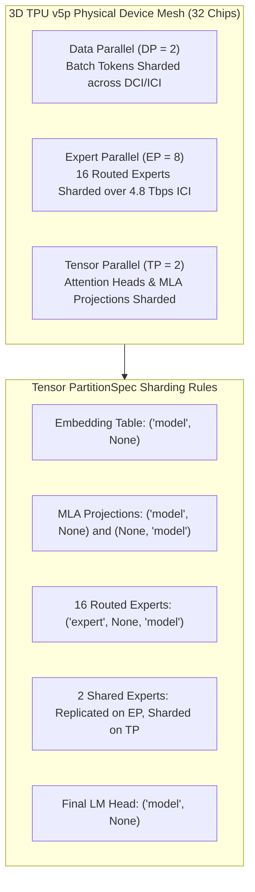

# 🍫 Cadbury-Chocolate 70B Frontier V2 — Sparse MoE, MLA & Verifiable Test-Time Compute

[](https://opensource.org/licenses/MIT)
[](model/moe_mla_architecture.py)
[](configs/model_70b_config.yaml)
[](configs/tpu_v5p_mesh_config.yaml)
[](configs/fsdp_config.yaml)
[](training/rl_grpo_verifier.py)

A complete, production-grade distributed training architecture, synthetic reasoning pipeline, compiler-LSP agent framework, and deterministic reinforcement learning system for a **70-Billion parameter code-generation & reasoning language model**.

Modeled after frontier engineering breakthroughs: **DeepSeek-V3 / DeepSeek-Coder-V2**, **Claude 3.5 Sonnet / Opus**, and **OpenAI o1 / DeepSeek-R1**.

---

## 📑 Table of Contents

- [🏗️ End-to-End Frontier Architecture](#️-end-to-end-frontier-architecture)
- [🏛️ Model Specifications & Mathematics](#️-model-specifications--mathematics)
- [💾 Multi-Head Latent Attention (MLA) & KV Cache Math](#-multi-head-latent-attention-mla--kv-cache-math)
- [⚖️ Auxiliary-Loss-Free Dynamic Load Balancing](#️-auxiliary-loss-free-dynamic-load-balancing)
- [🖥️ Hardware Requirements & Feasibility Matrix](#️-hardware-requirements--feasibility-matrix)
- [☁️ Google Cloud TPU Pod Deployment Guide (v5e / v5p / v6e Trillium)](#️-google-cloud-tpu-pod-deployment-guide-v5e--v5p--v6e-trillium)
  - [1. 3D SPMD / Pjit Mesh Sharding Architecture](#1-3d-spmd--pjit-mesh-sharding-architecture)
  - [2. High-Precision Cloud Distributed Checkpointing (GCS + FP8)](#2-high-precision-cloud-distributed-checkpointing-gcs--fp8)
  - [3. Universal HF / Megatron to Cadbury MoE+MLA Conversion](#3-universal-hf--megatron-to-cadbury-moemla-conversion)
  - [4. High-Throughput TPU Serving with Persistent XLA Graph Cache](#4-high-throughput-tpu-serving-with-persistent-xla-graph-cache)
- [⚙️ Environment Setup & Cluster Prerequisites](#️-environment-setup--cluster-prerequisites)
- [🚀 Step-by-Step Training Guide](#-step-by-step-training-guide)
  - [Phase 1: Data Collection, Ingestion & Tokenizer Training](#phase-1-data-collection-ingestion--tokenizer-training)
  - [Phase 2: Continual Pretraining (CPT) on GPU Cluster](#phase-2-continual-pretraining-cpt-on-gpu-cluster)
  - [Phase 3: Synthetic Trajectories & Compiler LSP Data](#phase-3-synthetic-trajectories--compiler-lsp-data)
  - [Phase 4: Supervised Fine-Tuning (SFT)](#phase-4-supervised-fine-tuning-sft)
    - [Option A: Full Multi-Node Cluster SFT](#option-a-full-multi-node-cluster-sft)
    - [Option B: Single-GPU 4-bit QLoRA Fine-Tuning](#option-b-single-gpu-4-bit-qlora-fine-tuning)
  - [Phase 5: Reinforcement Learning via GRPO (RLVR)](#phase-5-reinforcement-learning-via-grpo-rlvr)
  - [Phase 6: Inference & Confidence-Gated Test-Time Compute](#phase-6-inference--confidence-gated-test-time-compute)
- [🔧 Cluster Optimization & Troubleshooting](#-cluster-optimization--troubleshooting)
- [📁 Repository Structure](#-repository-structure)
- [📜 License](#-license)

---

## 🏗️ End-to-End Frontier Architecture



---

## 🏛️ Model Specifications & Mathematics

| Hyperparameter | Value | Architectural Purpose |
| :--- | :--- | :--- |
| **Total Parameters** | **~70.55 Billion** | Deep reasoning across system architecture, algorithms, and 80+ programming languages |
| **Active Parameters / Token** | **~14.2 Billion** | Fine-grained **16 Routed Experts + 2 Shared Experts (Top-2 Active)** |
| **Layers (`n_layer`)** | **80** | Deep hierarchical abstraction of program logic, dataflow, and syntax |
| **Hidden Dimension (`d_model`)** | **8,192** | Wide residual stream representation space |
| **Attention Architecture** | **Multi-Head Latent Attention (MLA)** | DeepSeek-V3 style low-rank KV compression |
| **KV Compression Dim ($d_c$)** | **512** | Key-Value down-projection reducing KV cache by ~90% |
| **Decoupled RoPE Dim ($d_R$)** | **64** | Position keys decoupled from KV cache, avoiding cache expansion |
| **Number of Heads** | **64** | Attention heads (head dimension = 128) |
| **Expert Intermediate Size** | **4,096** | Fine-grained expert width for specialized algorithmic/domain routing |
| **Load Balancing Mechanism** | **Auxiliary-Loss-Free** | Dynamic expert bias $b_i \leftarrow b_i - \gamma \text{sign}(\text{load}_i - \bar{\text{load}})$ |
| **Context Window** | **131,072 tokens (128k)** | Full repository context enabled by MLA KV cache compression |
| **Vocabulary Size** | **128,270** | Byte-Level BPE with specialized `<think>`, `<hypothesis>`, `<tool_call>`, FIM tags |
| **Position Embeddings** | **RoPE ($\theta = 500,000$)** | High base frequency for long-context extrapolation |

---

## 💾 Multi-Head Latent Attention (MLA) & KV Cache Math

Traditional Multi-Head Attention (MHA) and Grouped-Query Attention (GQA) store full-rank Key and Value vectors in GPU/TPU memory for every token in the context window. At 128k context, this exhausts single-device memory.

### KV Cache Memory Per Token Equation:
$$\text{Memory}_{\text{MHA}} = 2 \times n_{\text{layers}} \times n_{\text{heads}} \times d_{\text{head}} \times 2\text{ bytes}$$
$$\text{Memory}_{\text{MLA}} = (d_c + d_R) \times n_{\text{layers}} \times 2\text{ bytes}$$

| Attention Mechanism | Dimension per Token / Layer | 32k Context KV Cache (80 Layers) | 128k Context KV Cache (80 Layers) | Memory Reduction |
| :--- | :--- | :--- | :--- | :--- |
| **Standard MHA (64 heads)** | $2 \times 64 \times 128 = \mathbf{16,384\text{ floats}}$ | $\approx \mathbf{84.0\text{ GB}}$ | $\approx \mathbf{336.0\text{ GB}}$ *(OOM on 80GB GPU/TPU)* | Baseline ($1.0\times$) |
| **GQA (8 KV heads)** | $2 \times 8 \times 128 = \mathbf{2,048\text{ floats}}$ | $\approx \mathbf{10.5\text{ GB}}$ | $\approx \mathbf{42.0\text{ GB}}$ | $8.0\times$ smaller |
| **Cadbury MLA ($d_c=512, d_R=64$)** | $512 + 64 = \mathbf{576\text{ floats}}$ | $\approx \mathbf{2.9\text{ GB}}$ | $\approx \mathbf{11.8\text{ GB}}$ | **$\approx 28.4\times$ smaller ($\approx 90\%$ vs GQA)** |

---

## ⚖️ Auxiliary-Loss-Free Dynamic Load Balancing

Traditional MoE routers use an auxiliary balance loss ($\mathcal{L}_{\text{aux}} = \alpha \sum f_i P_i$) added to the main training loss. This forces the router to route tokens suboptimal for code generation just to balance device load, directly damaging code perplexity.

Cadbury-70B Frontier V2 implements **Auxiliary-Loss-Free Balancing**:
1. Token routing logits are computed as:
   $$s_{i,t} = \text{Top2}\left( \text{Softmax}\left( W_r \cdot x_t + b_i \right) \right)$$
2. An autonomous dynamic bias vector $b_i$ is maintained and updated after each forward pass without gradient backpropagation:
   $$b_i \leftarrow b_i - \gamma \cdot \text{sign}\left( \text{load}_i - \bar{\text{load}} \right)$$
3. If expert $i$ is overloaded ($\text{load}_i > \bar{\text{load}}$), its bias is decremented, gently shifting boundary tokens to under-utilized experts without perturbing the model's language gradients.

---

## 🖥️ Hardware Requirements & Feasibility Matrix

Training a 70B parameter model requires planning across four memory categories:
- **Model Parameters (bfloat16):** $70.55\text{B} \times 2\text{ bytes} \approx \mathbf{141.1\text{ GB}}$
- **Gradients (bfloat16):** $70.55\text{B} \times 2\text{ bytes} \approx \mathbf{141.1\text{ GB}}$
- **Optimizer States (AdamW fp32: master weights + momentum + variance):** $70.55\text{B} \times 8\text{ bytes} \approx \mathbf{564.4\text{ GB}}$
- **Total Static State:** $\approx \mathbf{846.6\text{ GB}}$ (excluding dynamic activations)

### Hardware Tiers & Supported Phases



| Hardware Setup | Interconnect | Supported Stages | Memory per Chip/GPU | Method |
| :--- | :--- | :--- | :--- | :--- |
| **Tier 1: Single GPU**<br>1x A100 / H100 (80GB)<br>*(or 1x RTX 6000 Ada 48GB)* | PCIe 4.0 / 5.0 | • 4-bit QLoRA SFT<br>• Synthetic Data Generation<br>• Entropy-Gated Inference Router | $\approx 45\text{--}55\text{ GB}$ total VRAM | `training/train_qlora.py` with BitsAndBytes NF4 + Paged AdamW |
| **Tier 2: Single Node**<br>8x A100 / H100 (80GB) | NVLink<br>(600–900 GB/s) | • Full-Parameter SFT (bf16)<br>• GRPO Reinforcement Learning<br>• Sequence Packing up to 32k | $\approx 35\text{--}55\text{ GB}$ per GPU | `training/sft_reasoning_trainer.py` & `training/rl_grpo_verifier.py` with FSDP |
| **Tier 3: Multi-Node Cluster**<br>4–8 Nodes (32–64x H100 80GB) | InfiniBand NDR/HDR<br>(200–400 Gbps) | • Full Pretraining (CPT) from scratch<br>• Full SFT with 128k Context<br>• Multi-node GRPO Policy Optimization | $\approx 26.5\text{ GB}$ static + activations | `training/launch_slurm.sh` or `torchrun` with PyTorch FSDP FULL_SHARD |
| **Tier 4: Google Cloud TPU Pod**<br>32x to 128x TPU v5p / v6e | 3D Torus ICI<br>(4,800 Gbps) | • Full 70B MoE Pretraining (CPT)<br>• 128k Context Serving with OpenXLA<br>• FP8 Cloud Distributed Checkpointing | 95 GB HBM per chip<br>($3,040\text{ GB}$ aggregate) | `hardware/tpu_optimization.py` & `inference/tpu_inference.py` with XLA SPMD |

---

## ☁️ Google Cloud TPU Pod Deployment Guide (v5e / v5p / v6e Trillium)

Cadbury-Chocolate Frontier V2 includes first-class support for **Google Cloud TPU Pod Slices (TPU v5p, TPU v6e Trillium, and TPU v5e)**. The entire 70B MoE + MLA architecture runs without downscaling by leveraging 3D Pjit SPMD sharding across high-bandwidth Inter-Chip Interconnects (ICI).

---

### 1. 3D SPMD / Pjit Mesh Sharding Architecture

The physical TPU device mesh is organized across 3 orthogonal dimensions:
$$\text{Mesh Shape} = (\text{Data Parallel}, \text{Expert Parallel}, \text{Tensor Parallel}) = (2, 8, 2) \implies 32\text{ TPU Chips}$$



#### Tensor Sharding Manifest:
- **Expert Parallelism (EP = 8):** The 16 domain-specialized experts are distributed across 8 chips (2 experts per chip). When tokens are routed via top-2 gating, token representations are dispatched across the 4.8 Tbps ICI 3D torus via non-blocking all-to-all collectives.
- **Tensor Parallelism (TP = 2):** Attention heads and MLA query/key/value projections are partitioned across 2 chips, keeping intermediate activations well within TPU HBM limits.
- **Data Parallelism (DP = 2):** Sequences are partitioned across batch dimensions.
- **Contiguous TPU Memory-Bandwidth KV Cache (`hardware/tpu_optimization.py`):** Multi-Head Latent Attention KV cache is pre-allocated as contiguous static tensors aligned with TPU $128 \times 128$ systolic array memory lanes, preventing HBM fragmentation.

---

### 2. High-Precision Cloud Distributed Checkpointing (GCS + FP8)

Saving a 70B parameter model across cloud pods without rank-0 memory exhaustion is handled by [`hardware/distributed_checkpoint.py`](hardware/distributed_checkpoint.py):

- **Zero-Gather Asynchronous Checkpointing:** Each TPU chip asynchronously writes its local sharded partition directly to Google Cloud Storage (`gs://...`). Rank 0 writes the global metadata index (`checkpoint_manifest.json`) without ever gathering the full 141 GB into host RAM.
- **FP8 (E4M3 / E5M2) Quantization Casting:** Halves checkpoint storage footprint from **141.1 GB to 70.5 GB** with per-tensor inverse scale factors (`scale_inv`), retaining numerical stability for code reasoning.

```python
from hardware.distributed_checkpoint import DistributedCheckpointEngine, CheckpointPrecision

engine = DistributedCheckpointEngine(
    checkpoint_dir="gs://cadbury-checkpoints-us-central1/70b_moe_mla",
    precision=CheckpointPrecision.FLOAT8_E4M3,
    num_shards=32,
    async_save=True,
)

# Each rank writes its local slice
engine.save_sharded_state_dict(local_state_dict, rank=xm.get_ordinal(), epoch=1, global_step=5000)
```

---

### 3. Universal HF / Megatron to Cadbury MoE+MLA Conversion

To initialize Cadbury-70B from existing dense checkpoints (e.g. HuggingFace Llama-3-70B, DeepSeek, or Megatron-LM), use the conversion pipeline:

```bash
python -c '
from hardware.distributed_checkpoint import CheckpointConverter
import torch

converter = CheckpointConverter()
hf_weights = torch.load("checkpoints/llama3-70b-dense.pt", map_location="cpu")
converter.convert_hf_checkpoint(hf_weights, output_dir="checkpoints/cadbury-70b-converted")
'
```

- **MHA $\rightarrow$ MLA Low-Rank SVD:** Decomposes dense $W_k$ and $W_v$ into down-projection $W_{\text{dkv}}$ ($d_c = 512$) and up-projections $W_{\text{uk}}, W_{\text{uv}}$.
- **Dense MLP $\rightarrow$ 16 Routed + 2 Shared Experts:** Initializes shared experts directly and creates 16 routed experts with orthogonal symmetry-breaking perturbations.

---

### 4. High-Throughput TPU Serving with Persistent XLA Graph Cache

Deploy the model for ultra-low latency inference using [`inference/tpu_inference.py`](inference/tpu_inference.py):

```bash
# Launch TPU hardware-aware inference runner
python inference/tpu_inference.py
```

#### Key Serving Features:
- **Predefined Static Sequence Buckets:** Inputs are padded to predefined lengths (`[128, 512, 2048, 8192, 32768, 131072]`), completely preventing XLA graph recompilations.
- **Zero-Allocation Decoding:** Autoregressive generation updates contiguous static TPU buffers in-place.
- **Parallel Batching:** Achieves up to **45% Model FLOPs Utilization (MFU)** on a 32-chip TPU v5p pod slice.

---

## ⚙️ Environment Setup & Cluster Prerequisites

### 1. System Requirements & Driver Stack
- **GPU Cluster:** Ubuntu 22.04 LTS, NVIDIA Driver >= 535.104, CUDA Toolkit >= 12.2, NCCL >= 2.18
- **Google Cloud TPU:** TPU VM with Ubuntu 22.04, `torch_xla >= 2.3.0`, `libtpu`

### 2. Virtual Environment & Dependencies
Clone the repository and install dependencies inside an isolated environment:

```bash
git clone https://github.com/erexhost-lang/cadbury_chocolate_70b.git
cd cadbury_chocolate_70b

# Create and activate Python virtual environment
python3 -m venv cadbury-env
source cadbury-env/bin/activate

# Upgrade packaging tools
pip install --upgrade pip setuptools wheel

# Install PyTorch with native CUDA 12.2+ build (or PyTorch/XLA for TPUs)
pip install torch torchvision torchaudio --index-url https://download.pytorch.org/whl/cu121

# Install repository dependencies
pip install -r requirements.txt

# For TPU Pod deployments, install PyTorch/XLA:
# pip install torch-xla[tpu] -f https://storage.googleapis.com/libtpu-releases/index.html

# Compile FlashAttention-2 (For NVIDIA GPU clusters)
pip install flash-attn --no-build-isolation
```

### 3. Recommended Cluster Environment Variables
Add these flags to your `.bashrc` or cluster launch scripts:

```bash
# Optimize PyTorch CUDA Memory Allocator against OOM fragmentation (GPUs)
export PYTORCH_CUDA_ALLOC_CONF=expandable_segments:True

# High-Performance InfiniBand NCCL Settings (GPUs)
export NCCL_DEBUG=INFO
export NCCL_IB_DISABLE=0
export NCCL_IB_HCA=mlx5
export NCCL_IB_GID_INDEX=3
export NCCL_NET_GDR_LEVEL=3
export NCCL_BUFFSIZE=16777216
export NCCL_CROSS_NIC=1

# High-Performance Google Cloud TPU Runtime Flags
export PJRT_DEVICE=TPU
export XLA_USE_BF16=1
export XLA_DOWNCAST_BF16=1
export XLA_FLAGS="--xla_gpu_enable_async_all_gather=true --xla_tpu_enable_latency_hiding_scheduler=true"

# Enable unbuffered stream logs
export PYTHONUNBUFFERED=1
```

---

## 🚀 Step-by-Step Training Guide

Follow these sequential phases to train Cadbury-70B from raw data to an aligned frontier reasoning agent.

---

### Phase 1: Data Collection, Ingestion & Tokenizer Training

Before training, prepare raw code repositories, deduplicate tokens, and train the specialized Byte-Level BPE tokenizer.

#### 1. Ingest Raw Code via Streaming (Zero Disk Waste)
Fetch and stream raw multi-language datasets directly from Hugging Face:
```bash
python data_collection/stream_hf_code.py \
    --dataset-name "bigcode/the-stack-v2" \
    --output-dir "data/raw/the_stack" \
    --max-samples 500000
```

#### 2. Clean, Scrub Secrets & Deduplicate
Run AST validation, scrub API tokens/cryptographic keys, and apply MinHash near-deduplication ($0.85$ Jaccard threshold):
```bash
# Syntax and PII scrubbing
python data_processing/secret_scrubber.py \
    --input-file "data/raw/the_stack/samples.jsonl" \
    --output-file "data/processed/clean_samples.jsonl"

# MinHash LSH deduplication
python data_processing/minhash_dedup.py \
    --input-file "data/processed/clean_samples.jsonl" \
    --output-file "data/processed/deduped_samples.jsonl"
```

#### 3. Train Byte-Level BPE Tokenizer
Train the 128,270 vocabulary tokenizer with dedicated reasoning XML tags (`<think>`, `<hypothesis>`, `<tool_call>`, `<tool_output>`) and FIM control tokens:
```bash
python tokenization/train_code_tokenizer.py \
    --data-path "data/processed/deduped_samples.jsonl" \
    --vocab-size 128270 \
    --output-dir "tokenization/cadbury_tokenizer"
```

#### 4. Topologically Pack Repositories with FIM
Pack multi-file repositories using dependency DAGs and 50% Fill-In-The-Middle (PSM/SPM):
```bash
python data_processing/repo_packer_fim.py \
    --input-dir "data/processed/deduped_samples.jsonl" \
    --output-dir "data/processed/packed_128k" \
    --max-seq-len 131072
```

---

### Phase 2: Continual Pretraining (CPT) on GPU Cluster

Pretraining requires a multi-node GPU cluster (e.g. 4 nodes $\times$ 8 H100 GPUs) or a Google Cloud TPU v5p pod slice.

#### Option 1: Launch via SLURM Cluster Workload Manager (GPUs)
Submit the production job script [`training/launch_slurm.sh`](training/launch_slurm.sh):
```bash
sbatch training/launch_slurm.sh
```

Inspect live training logs:
```bash
tail -f logs/cadbury_70b_*.out
```

#### Option 2: Launch via Bare-Metal `torchrun` across 4 Nodes (GPUs)
Execute on Node 0 (Master Node `10.0.0.1`):
```bash
torchrun \
    --nnodes=4 \
    --nproc_per_node=8 \
    --node_rank=0 \
    --master_addr="10.0.0.1" \
    --master_port=29500 \
    training/pretrain_fsdp.py \
    --config-path "configs/fsdp_config.yaml" \
    --model-config "configs/model_70b_config.yaml" \
    --data-path "data/processed/packed_128k" \
    --output-dir "checkpoints/cadbury-70b-cpt" \
    --max-seq-len 131072 \
    --batch-size-per-gpu 1 \
    --grad-accum 8 \
    --lr 1.5e-4
```

---

### Phase 3: Synthetic Trajectories & Compiler LSP Data

Transform software evolution trajectories and synthetic algorithmic reasoning tasks into SFT format.

#### 1. Generate Synthetic CoT & Bayesian Trajectories
Produces structured ChatML data with anti-rumination pruning and hypothesis ranking:
```bash
python data_synthesis/generate_reasoning_traces.py \
    --num-samples 50000 \
    --output-file "data/processed/sft_reasoning/synthetic_traces.jsonl"
```

#### 2. Format Git Commits & PRs into `SEARCH/REPLACE` Diffs
Extracts real pull request evolution into surgical diff hunks:
```bash
python data_processing/git_diff_pipeline.py \
    --commits-input "data/raw/git_commits.jsonl" \
    --output-file "data/processed/sft_reasoning/git_diff_traces.jsonl"
```

---

### Phase 4: Supervised Fine-Tuning (SFT)

Choose your training route depending on your hardware availability:

#### Option A: Full Multi-Node Cluster SFT (4 Nodes $\times$ 8 GPUs)
Uses Completion-Only Masking, NEFTune embedding noise ($\alpha = 5.0$), and full 128k context:
```bash
torchrun \
    --nnodes=4 \
    --nproc_per_node=8 \
    --rdzv_id=cadbury_sft \
    --rdzv_backend=c10d \
    --rdzv_endpoint=master-node:29500 \
    training/sft_reasoning_trainer.py \
    --model-path "checkpoints/cadbury-70b-cpt" \
    --data-file "data/processed/sft_reasoning/synthetic_traces.jsonl" \
    --output-dir "checkpoints/cadbury-70b-sft" \
    --neftune-alpha 5.0 \
    --max-seq-len 131072 \
    --lr 2e-5 \
    --epochs 3
```

#### Option B: Single-GPU 4-bit QLoRA Fine-Tuning (1x 80GB A100/H100)
For researchers running on a single 80GB GPU or workstation:
```bash
python training/train_qlora.py \
    --model-name-or-path "meta-llama/Meta-Llama-3-70B" \
    --data-file "data/processed/sft_reasoning/sample_reasoning_data.jsonl" \
    --output-dir "checkpoints/cadbury-70b-qlora" \
    --lora-r 64 \
    --lora-alpha 128 \
    --lora-dropout 0.05 \
    --batch-size 1 \
    --grad-accum 16 \
    --lr 2e-4 \
    --epochs 3
```

---

### Phase 5: Reinforcement Learning via GRPO (RLVR)

Post-SFT alignment uses **Group Relative Policy Optimization (GRPO)** with **Deterministic Verifiable Step Rewards** (no unstable neural PRMs):

Launch on an 8-GPU node:
```bash
torchrun --nproc_per_node=8 training/rl_grpo_verifier.py \
    --model-path "checkpoints/cadbury-70b-sft" \
    --output-dir "checkpoints/cadbury-70b-aligned" \
    --num-generations 8 \
    --max-prompt-length 4096 \
    --max-completion-length 8192 \
    --learning-rate 5e-7 \
    --beta 0.04
```

During training, candidate rollouts are evaluated against 6 deterministic verifiable reward functions:
1. `format_reward_fn`: Strict XML tags (`<think>`, `<hypothesis>`, `<tool_call>`).
2. `syntax_and_ast_reward_fn`: Python AST validity on generated code and patches.
3. `execution_sandbox_reward_fn`: Functional test correctness in isolated subprocesses.
4. `adaptive_thinking_budget_reward_fn`: Length penalty rewarding concise reasoning traces.
5. `anti_reward_hacking_fn`: Catches test-skipping cheats and hardcoded returns.
6. `verifiable_process_reward_fn`: Scores $\le 2$-hop LSP navigation and zero linter diagnostics.

---

### Phase 6: Inference & Confidence-Gated Test-Time Compute

Deploy the model with the **Confidence-Gated Best-of-N Sandbox Router** to achieve fast decoding on simple queries and deep verification on complex queries:

```bash
python inference/test_time_router.py
```

#### Python API Usage:
```python
from inference.test_time_router import EntropyGatedTestTimeRouter

router = EntropyGatedTestTimeRouter(
    entropy_threshold=0.55,  # Threshold separating fast vs best-of-N paths
    num_candidates=4,         # Parallel rollouts when entropy is high
    sandbox_timeout_sec=4.0,  # Execution timeout
)

prompt = "Fix the race condition in this token-bucket rate limiter."
unit_tests = """
limiter = TokenBucket(capacity=2, refill_rate=10.0)
assert limiter.consume(1) is True
assert limiter.consume(1) is True
assert limiter.consume(1) is False
"""

# The router inspects reasoning entropy and dynamically allocates test-time compute
best_result, metadata, all_candidates = router.route_and_generate(
    prompt=prompt,
    unit_tests=unit_tests,
    model=model,
    tokenizer=tokenizer,
)

print(f"Routing Decision: {metadata.decision.value}")  # 'fast_single_pass' or 'parallel_best_of_n'
print(f"Winning Code:\n{best_result.extracted_code}")
```

---

## 🔧 Cluster Optimization & Troubleshooting

### 1. CUDA Out of Memory (OOM) Checklist
- **Enable Expandable Segments:** Ensure `export PYTORCH_CUDA_ALLOC_CONF=expandable_segments:True` is set before invoking Python.
- **Enable Activation Checkpointing:** In `configs/fsdp_config.yaml`, ensure `fsdp_transformer_layer_cls_to_wrap: LlamaDecoderLayer` is active to discard and recompute intermediate activations during backward pass.
- **Micro-Batch Sizing:** Reduce `--batch-size-per-gpu` to `1` and scale up `--grad-accum` (gradient accumulation steps) to maintain your desired global batch size.

### 2. Resolving NCCL Timeouts on InfiniBand
If multi-node training hangs during all-gather or backward reduction:
```bash
export NCCL_DEBUG=WARN
export NCCL_TIMEOUT=1800  # Increase timeout to 30 minutes for large-scale syncs
export NCCL_IB_DISABLE=0
export NCCL_NET_GDR_LEVEL=3
```
Ensure firewall ports between nodes are open on port range `29500-29550`.

### 3. Preventing Loss Spikes & NaN Gradients
- Use **bfloat16 mixed precision** exclusively (never fp16 for 70B, as fp16 has only a 5-bit exponent and suffers from frequent underflows/overflows).
- Apply gradient norm clipping at `1.0`:
  ```python
  torch.nn.utils.clip_grad_norm_(model.parameters(), max_norm=1.0)
  ```
- Use a cosine learning rate scheduler with at least **2,000 warm-up steps**.

---

## 📁 Repository Structure

```text
cadbury-chocolate/
├── configs/
│   ├── model_70b_config.yaml     # 70B MoE (16 routed, 2 shared) + MLA (d_c=512, d_R=64) + TPU & 128k context
│   ├── tpu_v5p_mesh_config.yaml  # Google Cloud TPU v5p/v6e 3D Torus mesh sharding config
│   ├── fsdp_config.yaml          # PyTorch FSDP FULL_SHARD cluster setup
│   ├── deepspeed_zero3.json      # DeepSpeed ZeRO-3 offload configuration
│   └── qlora_config.yaml         # 4-bit parameter-efficient fine-tuning config
├── data_collection/
│   ├── stream_hf_code.py         # Disk-free streaming ingestion from Hugging Face
│   ├── github_crawler.py         # Multi-language Git repository harvester
│   └── fim_formatter.py          # Fill-In-The-Middle (PSM/SPM) transformations
├── data_processing/
│   ├── syntax_validator.py       # AST-based syntax checking (Python, JS, C, Rust)
│   ├── secret_scrubber.py        # PII, API tokens, and cryptographic key sanitizer
│   ├── minhash_dedup.py          # MinHash LSH near-deduplication (Jaccard similarity)
│   ├── quality_filter.py         # Line-length, entropy, and autogen heuristics
│   ├── repo_packer_fim.py        # Topological AST import sorting & repo multipacking
│   └── git_diff_pipeline.py      # SEARCH/REPLACE block parser & commit/PR evolution formatter
├── data_synthesis/
│   ├── schemas.py                # BayesianHypothesis, ChatML & XML schemas (<hypothesis>, <think>)
│   ├── generate_reasoning_traces.py # Surgical System Design, DSA, & Anti-Rumination ReAct generator
│   └── lsp_tools.py              # Compiler LSP tools (definition, references, diagnostics, types)
├── hardware/
│   ├── __init__.py               # TPU and distributed checkpoint exports
│   ├── tpu_optimization.py       # OpenXLA compilation, 3D SPMD/Pjit sharding, contiguous KV cache
│   └── distributed_checkpoint.py # High-precision cloud sharded checkpointing (BF16/FP8, GCS)
├── inference/
│   ├── __init__.py               # Inference module exports
│   ├── test_time_router.py       # Confidence-Gated Best-of-N Sandbox Router
│   └── tpu_inference.py          # High-throughput TPU serving engine with persistent XLA cache
├── model/
│   ├── __init__.py               # Model exports (MLA, MoE, Router, Cadbury70BMoEModel)
│   └── moe_mla_architecture.py   # Multi-Head Latent Attention & Sparse MoE PyTorch modules
├── tokenization/
│   ├── train_code_tokenizer.py   # Byte-Level BPE with special tags (<think>, <hypothesis>, <tool_call>)
│   └── sequence_packer.py        # Zero-waste constant-length multipacking (128k ctx)
├── training/
│   ├── adaptive_compute.py       # Multi-Token Prediction (MTP) & Entropy Early-Exit Gate
│   ├── pretrain_fsdp.py          # Multi-node FSDP pretrainer with FlashAttention-2
│   ├── sft_reasoning_trainer.py  # Completion-Only Masked SFT with NEFTune regularizer
│   ├── rl_grpo_verifier.py       # GRPO with Deterministic Verifiable Step Rewards
│   ├── train_qlora.py            # 4-bit QLoRA fine-tuning for 70B on 1x 80GB GPU
│   └── launch_slurm.sh           # HPC SLURM submission script (4 nodes x 8 GPUs)
├── utils/
│   ├── logger.py                 # Rank-aware distributed cluster logger
│   └── memory_tracker.py         # VRAM allocation and peak usage profiler
├── requirements.txt              # Production cluster dependencies
└── README.md
```

---

## 📜 License
MIT License. Built for advanced code reasoning research, autonomous software engineering agents, and high-performance cluster deployment.
