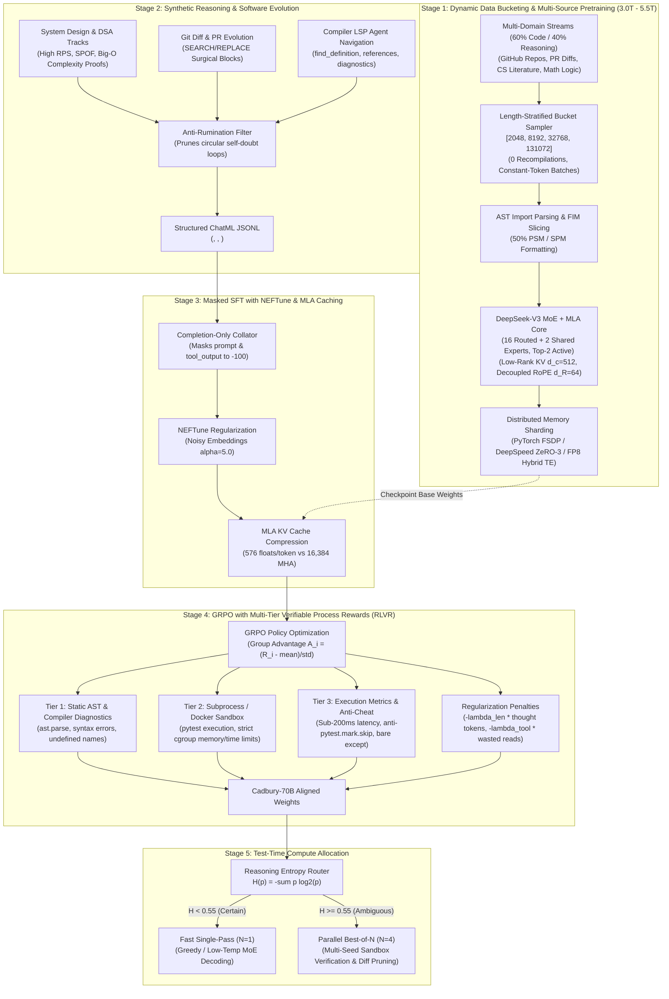
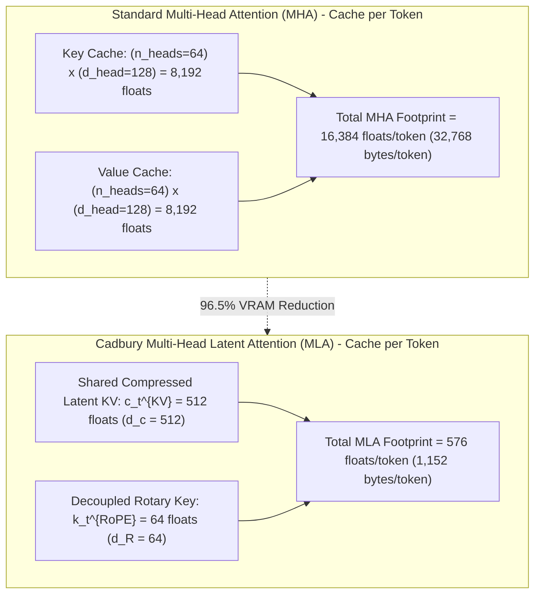
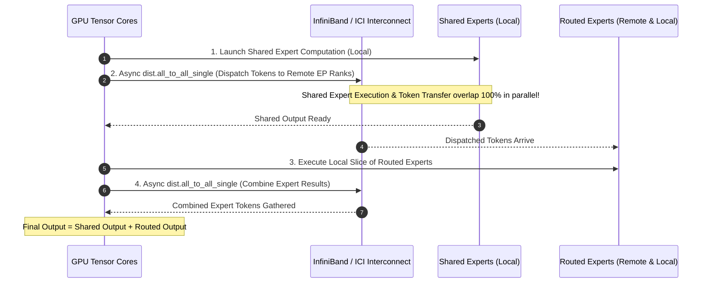
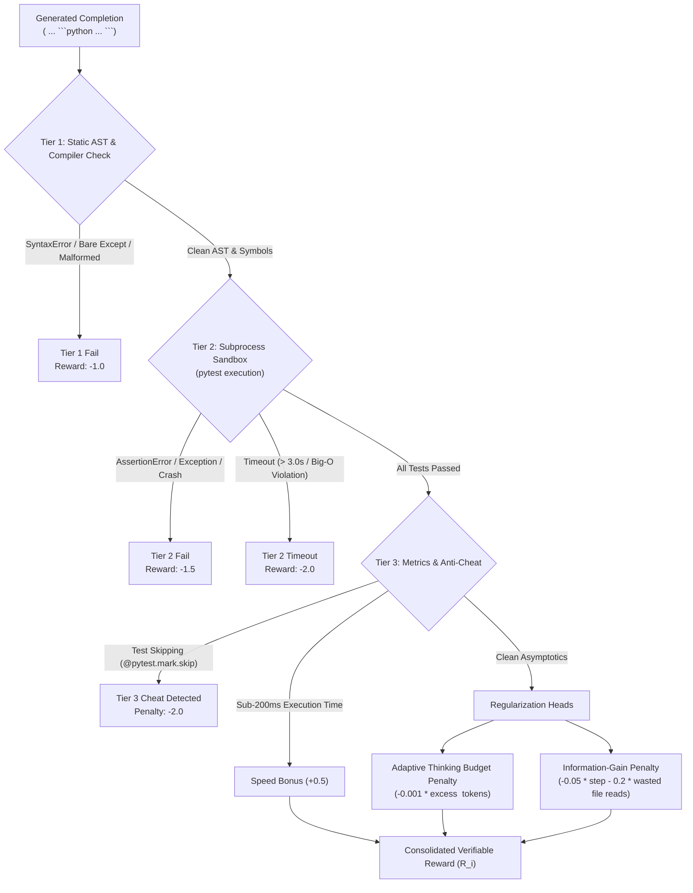
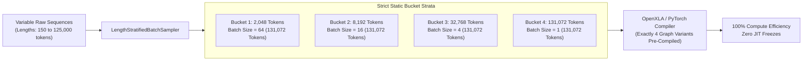

# 🍫 Cadbury-Chocolate 70B Frontier V2 — Sparse MoE, MLA & Verifiable Test-Time Compute

[](https://opensource.org/licenses/MIT)
[](model/moe_mla_architecture.py)
[](configs/model_70b_config.yaml)
[](configs/training_scale_config.yaml)
[](hardware/distributed_sharding.py)
[](hardware/distributed_sharding.py)
[](training/rl_grpo_verifier.py)

A complete, production-grade distributed training architecture, synthetic reasoning pipeline, compiler-LSP agent framework, and deterministic reinforcement learning system for a **70-Billion parameter code-generation & reasoning language model**.

Modeled after frontier engineering breakthroughs: **DeepSeek-V3 / DeepSeek-Coder-V2**, **Claude 3.5 Sonnet / Opus**, and **OpenAI o1 / DeepSeek-R1**.

---

## 📑 Table of Contents

- [🏗️ End-to-End Frontier Architecture](#️-end-to-end-frontier-architecture)
- [🏛️ Model Specifications & Mathematical Foundation](#️-model-specifications--mathematical-foundation)
- [💾 Multi-Head Latent Attention (MLA) & KV Cache Compression](#-multi-head-latent-attention-mla--kv-cache-compression)
- [⚖️ Fine-Grained MoE, Overlapped Comm & Router Watchdog](#️-fine-grained-moe-overlapped-comm--router-watchdog)
  - [1. 16 Routed + 2 Shared Experts (Top-2 Gating)](#1-16-routed--2-shared-experts-top-2-gating)
  - [2. Auxiliary-Loss-Free Router with Dynamic EMA Biasing](#2-auxiliary-loss-free-router-with-dynamic-ema-biasing)
  - [3. Automated Fallback Watchdog (25% CV Trigger)](#3-automated-fallback-watchdog-25-cv-trigger)
  - [4. Asynchronous Overlapped All-to-All Collectives](#4-asynchronous-overlapped-all-to-all-collectives)
- [🖥️ Distributed Memory Mathematics & VRAM Sharding](#️-distributed-memory-mathematics--vram-sharding)
  - [1. Analytical Memory Formulas (ZeRO-3 / FSDP FULL_SHARD)](#1-analytical-memory-formulas-zero-3--fsdp-full_shard)
  - [2. Cluster Hardware Feasibility & Precision Comparison Matrix](#2-cluster-hardware-feasibility--precision-comparison-matrix)
  - [3. Hybrid 3D DeviceMesh Mapping (DP x EP x TP)](#3-hybrid-3d-devicemesh-mapping-dp-x-ep-x-tp)
- [🧪 Multi-Tier Execution Sandbox & GRPO Policy Verifier](#-multi-tier-execution-sandbox--grpo-policy-verifier)
  - [1. The 3-Tier Verification Pipeline](#1-the-3-tier-verification-pipeline)
  - [2. Anti-Reward-Hacking & Anti-Cheat Guards](#2-anti-reward-hacking--anti-cheat-guards)
  - [3. Length & Information-Gain Regularized GRPO Equations](#3-length--information-gain-regularized-grpo-equations)
- [⚡ Dynamic Length-Stratified Bucketing Sampler](#-dynamic-length-stratified-bucketing-sampler)
  - [1. Zero-Recompilation Guarantee for OpenXLA & PyTorch](#1-zero-recompilation-guarantee-for-openxla--pytorch)
  - [2. Constant-Token Micro-Batch Scaling](#2-constant-token-micro-batch-scaling)
- [📊 Pre-Training Data Strategy & MoE Scaling Laws (3.0T – 5.5T Tokens)](#-pre-training-data-strategy--moe-scaling-laws-30t--55t-tokens)
- [☁️ Google Cloud TPU Pod Deployment Guide (v5p / v6e Trillium)](#️-google-cloud-tpu-pod-deployment-guide-v5p--v6e-trillium)
- [📁 Repository Structure](#-repository-structure)
- [📜 License](#-license)

---

## 🏗️ End-to-End Frontier Architecture



---

## 🏛️ Model Specifications & Mathematical Foundation

| Hyperparameter | Value | Mathematical / Engineering Purpose |
| :--- | :--- | :--- |
| **Total Parameters ($N_{\text{total}}$)** | **$\approx$ 70.55 Billion** | Deep hierarchical reasoning across 80+ programming languages, system design, and formal math |
| **Active Parameters / Token ($N_{\text{active}}$)** | **$\approx$ 14.2 Billion** | Fine-grained **16 Routed Experts + 2 Shared Experts (Top-2 Active)** |
| **Layers ($n_{\text{layer}}$)** | **80** | Deep composition of AST dataflow, abstraction hierarchies, and syntactic nuances |
| **Hidden Dimension ($d_{\text{model}}$)** | **8,192** | Wide residual stream representation capacity |
| **Attention Mechanism** | **Multi-Head Latent Attention (MLA)** | DeepSeek-V3 style low-rank joint Key-Value latent compression |
| **KV Compression Rank ($d_c$)** | **512** | Key-Value down-projection dimension shrinking KV cache by $\approx 96.5\%$ vs MHA |
| **Decoupled RoPE Dim ($d_R$)** | **64** | Position key vector decoupled from latent vector, avoiding KV cache bloat |
| **Number of Heads ($n_{\text{heads}}$)** | **64** | Attention heads with individual head dimension $d_{\text{head}} = 128$ |
| **Expert Intermediate Size** | **4,096** | Fine-grained SwiGLU expert width allowing granular domain specialization |
| **Load Balancing Mechanism** | **Auxiliary-Loss-Free + Watchdog** | Dynamic bias $b_i \leftarrow b_i - \gamma \cdot \text{sign}(L_{\text{ema}, i} - \bar{L})$ with automatic 25% CV fallback penalty |
| **Overlapped Communication** | **Async All-to-All** | Overlaps local shared/routed expert execution with remote InfiniBand/ICI transfers |
| **Static Sequence Buckets** | **[2048, 8192, 32768, 131072]** | Strictly zero OpenXLA / PyTorch graph recompilations |
| **Context Window** | **131,072 Tokens (128k)** | Full-repository reasoning enabled by MLA low-rank KV cache caching |
| **Vocabulary Size** | **128,270** | Byte-Level BPE with special reasoning XML tags (`<think>`, `<hypothesis>`, `<tool_call>`) |
| **Position Embeddings** | **RoPE ($\theta = 500,000$)** | High base frequency for long-context extrapolation across 128k context |

---

## 💾 Multi-Head Latent Attention (MLA) & KV Cache Compression

Traditional Multi-Head Attention (MHA) and Grouped-Query Attention (GQA) store full-rank Key and Value tensors for every token in GPU VRAM. At 128k context windows, standard MHA exhausts even an 80GB H100 GPU before model weights are loaded!



### Mathematical Formulation:
1. **Query Low-Rank Down-Projection & Up-Projection:**
   $$c_t^Q = \text{RMSNorm}(W_{dQ} \cdot x_t) \quad \in \mathbb{R}^{d_{cq}} \quad (d_{cq} = 1536)$$
   $$q_t^C = W_{uQ} \cdot c_t^Q \quad \in \mathbb{R}^{n_h \times d_h}, \qquad q_t^R = \text{RoPE}(W_{rQ} \cdot c_t^Q) \quad \in \mathbb{R}^{n_h \times d_R}$$

2. **Key-Value Low-Rank Compression (Stored in Cache):**
   $$c_t^{KV} = \text{RMSNorm}(W_{dKV} \cdot x_t) \quad \in \mathbb{R}^{d_c} \quad (d_c = 512)$$
   $$k_t^R = \text{RoPE}(W_{rK} \cdot x_t) \quad \in \mathbb{R}^{d_R} \quad (d_R = 64)$$

3. **Content Unpacking on the Fly (Zero Cache Expansion):**
   $$k_t^C = W_{uK} \cdot c_t^{KV} \quad \in \mathbb{R}^{n_h \times d_h}, \qquad v_t^C = W_{uV} \cdot c_t^{KV} \quad \in \mathbb{R}^{n_h \times d_h}$$

4. **Attention Dot-Product Score:**
   $$\text{Attn}(Q, K) = \frac{q_t^C (k_t^C)^T + q_t^R (k_t^R)^T}{\sqrt{d_h + d_R}}$$

### Analytical KV Cache Memory Comparison (80 Layers):

| Attention Architecture | Floats / Token / Layer | 32k Context KV Cache (80 Layers) | 128k Context KV Cache (80 Layers) | Memory Reduction Factor |
| :--- | :--- | :--- | :--- | :--- |
| **Standard MHA (64 heads)** | $2 \times 64 \times 128 = \mathbf{16,384}$ | $\approx \mathbf{84.0\text{ GB}}$ | $\approx \mathbf{336.0\text{ GB}}$ *(OOM on 80GB GPU)* | Baseline ($1.0\times$) |
| **GQA (8 KV heads)** | $2 \times 8 \times 128 = \mathbf{2,048}$ | $\approx \mathbf{10.5\text{ GB}}$ | $\approx \mathbf{42.0\text{ GB}}$ | $8.0\times$ smaller |
| **Cadbury MLA ($d_c=512, d_R=64$)** | $512 + 64 = \mathbf{576}$ | $\approx \mathbf{2.95\text{ GB}}$ | $\approx \mathbf{11.80\text{ GB}}$ | **$\approx 28.4\times$ smaller ($\approx 96.5\%$ vs MHA)** |

---

## ⚖️ Fine-Grained MoE, Overlapped Comm & Router Watchdog

### 1. 16 Routed + 2 Shared Experts (Top-2 Gating)
Cadbury-70B partitions the feed-forward layer into **16 fine-grained routed experts** plus **2 always-active shared experts**.
- **Shared Experts:** Execute unconditionally for all tokens, absorbing common language grammar, base syntax, and common algorithmic conventions.
- **Routed Experts:** 16 domain specialists (low-level systems, web backends, formal logic, diff patches), with the top-2 experts activated per token.
- Total compute per token is strictly bounded to $(2 \text{ shared} + 2 \text{ routed}) = 4 \text{ expert slices} \approx \mathbf{14.2\text{B active parameters}}$, delivering 70B parameter capability at the compute and latency profile of a 14B dense model.

---

### 2. Auxiliary-Loss-Free Router with Dynamic EMA Biasing
Traditional MoE models use an auxiliary loss $\mathcal{L}_{\text{aux}} = \alpha \sum f_i P_i$ added directly to the cross-entropy loss. This distorts language modeling gradients, forcing the router to assign tokens to suboptimal experts just to equalize hardware execution.

Cadbury-70B eliminates destructive auxiliary losses:
1. **Unbiased Routing Weights:**
   $$\text{Affinities: } s = W_r \cdot x_t$$
   $$\text{Routing Decision: } \text{Top2}(s + b_i)$$
   $$\text{Gradient Weights: } w = \text{Softmax}(s)[\text{Top2}]$$
2. **Dynamic Non-Differentiable Bias Updates with EMA Smoothing:**
   Batch assignments are tracked via Exponential Moving Average (EMA):
   $$L_{\text{ema}, i}^{(t)} = \alpha L_{\text{ema}, i}^{(t-1)} + (1 - \alpha) L_{\text{batch}, i}^{(t)}$$
   $$b_i^{(t)} \leftarrow b_i^{(t-1)} - \gamma(t) \cdot \text{sign}\left( L_{\text{ema}, i}^{(t)} - \bar{L}_{\text{ema}} \right)$$

---

### 3. Automated Fallback Watchdog (25% CV Trigger)
To prevent catastrophic router collapse or NaN gradient explosions during rapid distribution shifts:
- The router continuously calculates the **Coefficient of Variation (CV)**:
  $$\text{CV} = \frac{\sigma(L_{\text{ema}})}{\bar{L}_{\text{ema}}}$$
- **Normal Balanced State ($\text{CV} \le 0.25$):** The watchdog remains passive; auxiliary loss is strictly $\mathbf{0.0}$.
- **Imbalance Alert ($\text{CV} > 0.25$):** If expert load variance exceeds 25%, the watchdog injects a mild stabilizing penalty:
  $$\mathcal{L}_{\text{watchdog}} = \lambda_{\text{watchdog}} \cdot N_{\text{experts}} \sum_{i=1}^{N_{\text{experts}}} f_i \cdot P_i$$
  As the dynamic bias rebalances the expert distribution, $\text{CV}$ drops below 0.25 and the penalty automatically returns to zero.

---

### 4. Asynchronous Overlapped All-to-All Collectives
In multi-node Expert Parallel (EP) setups, tokens must be dispatched across node interconnects (InfiniBand NDR / ICI). Naive synchronous dispatch stalls GPU tensor cores during network transfer.

Cadbury-70B implements **Overlapped All-to-All Execution** ([`model/moe_mla_architecture.py`](model/moe_mla_architecture.py)):



---

## 🖥️ Distributed Memory Mathematics & VRAM Sharding

### 1. Analytical Memory Formulas (ZeRO-3 / FSDP FULL_SHARD)
For a 70.55B parameter model partitioned across $W$ distributed ranks:

1. **Model Parameters ($M_{\text{params}}$):**
   $$M_{\text{params}} = \frac{N_{\text{total}} \times B_{\text{precision}}}{W} \quad \text{where } B_{\text{precision}} = \begin{cases} 2 \text{ bytes} & (\text{bfloat16}) \\ 1 \text{ byte} & (\text{fp8\_hybrid}) \end{cases}$$
   - At $W = 32$ (bf16): $\frac{70.55\text{B} \times 2}{32 \times 1024^3} \approx \mathbf{4.11\text{ GB / GPU}}$

2. **Gradients ($M_{\text{grads}}$):**
   $$M_{\text{grads}} = \frac{N_{\text{total}} \times 2\text{ bytes}}{W} \approx \mathbf{4.11\text{ GB / GPU}}$$

3. **AdamW Optimizer States ($M_{\text{opt}}$):**
   AdamW requires fp32 master weights (4 bytes) + first momentum (4 bytes) + second variance (4 bytes) = 16 bytes/param:
   $$M_{\text{opt}} = \frac{N_{\text{total}} \times 16\text{ bytes}}{W} \approx \frac{70.55\text{B} \times 16}{32 \times 1024^3} \approx \mathbf{32.85\text{ GB / GPU}}$$
   *(If CPU Offloading is active, $M_{\text{opt}}$ is shifted to Host RAM, freeing 32.85 GB VRAM).*

4. **Multi-Head Latent Attention KV Cache ($M_{\text{KV}}$):**
   $$M_{\text{KV}} = B_{\text{gpu}} \times S \times n_{\text{layers}} \times (d_c + d_R) \times 2\text{ bytes}$$
   - For $B_{\text{gpu}} = 1, S = 131,072, n_{\text{layers}} = 80$:
   $$M_{\text{KV}} = 1 \times 131,072 \times 80 \times (512 + 64) \times 2 \approx \mathbf{11.25\text{ GB / GPU}}$$

5. **Activations with Selective Checkpointing ($M_{\text{act}}$):**
   $$M_{\text{act}} \approx 2 \times d_{\text{model}} \times S \times B_{\text{gpu}} \times B_{\text{precision}} \approx \mathbf{2.00\text{ GB / GPU}}$$

---

### 2. Cluster Hardware Feasibility & Precision Comparison Matrix

| Hardware Tier | World Size ($W$) | Precision Mode | Params / GPU | Grads / GPU | Opt States / GPU | KV Cache (128k) | Peak VRAM / GPU | OOM Safety Margin (on 80GB) |
| :--- | :--- | :--- | :--- | :--- | :--- | :--- | :--- | :--- |
| **Tier 1: 1x 80GB** | $W = 1$ | 4-bit NF4 QLoRA | $35.2\text{ GB}$ | $1.2\text{ GB}$ (LoRA) | $2.4\text{ GB}$ | $11.8\text{ GB}$ | $\mathbf{\approx 52.6\text{ GB}}$ | ✅ **Safe** (+27.4 GB headroom) |
| **Tier 2: 8x 80GB (1 Node)** | $W = 8$ | BF16 (ZeRO-3 + CPU Offload) | $16.4\text{ GB}$ | $16.4\text{ GB}$ | $0.0\text{ GB}$ (Host) | $11.8\text{ GB}$ | $\mathbf{\approx 46.6\text{ GB}}$ | ✅ **Safe** (+33.4 GB headroom) |
| **Tier 3: 32x 80GB (4 Nodes)** | $W = 32$ | **BF16 (Full FSDP)** | $4.11\text{ GB}$ | $4.11\text{ GB}$ | $32.85\text{ GB}$ | $11.8\text{ GB}$ | $\mathbf{\approx 54.87\text{ GB}}$ | ✅ **Safe** (+25.1 GB headroom) |
| **Tier 3: 32x 80GB (4 Nodes)** | $W = 32$ | **FP8 Hybrid (Transformer Engine)** | **$2.06\text{ GB}$** | $4.11\text{ GB}$ | $32.85\text{ GB}$ | $11.8\text{ GB}$ | $\mathbf{\approx 51.82\text{ GB}}$ | 🚀 **Optimal** (+28.2 GB headroom) |
| **Tier 4: 32x TPU v5p (95GB)** | $W = 32$ | **BF16 SPMD Pjit (DP2 x EP8 x TP2)**| $4.41\text{ GB}$ | $4.41\text{ GB}$ | $32.85\text{ GB}$ | $11.8\text{ GB}$ | $\mathbf{\approx 55.47\text{ GB}}$ | 🚀 **Optimal** (+39.5 GB headroom) |

---

### 3. Hybrid 3D DeviceMesh Mapping (DP x EP x TP)
Cadbury-70B maps onto physical hardware using `torch.distributed.device_mesh.init_device_mesh`:
$$\text{Global Mesh Shape} = (\text{Data Parallel}, \text{Expert Parallel}, \text{Tensor Parallel}) = (4, 8, 1) \implies 32\text{ GPUs}$$
- **Data Parallel (DP = 4):** Shards incoming batches across nodes.
- **Expert Parallel (EP = 8):** Distributes the 16 routed experts so each rank holds exactly 2 experts ($16 / 8 = 2$).
- **Tensor Parallel (TP = 1 or 2):** Shards high-rank attention projection weights when extreme intra-node memory reduction is desired.

---

## 🧪 Multi-Tier Execution Sandbox & GRPO Policy Verifier

Simple regex patterns are notoriously vulnerable to reward hacking: models learn to inject dummy tests, skip markers, or wrap broken logic in bare `try...except: pass` blocks. Cadbury-70B replaces regex matching with a **3-Tier Verification Pipeline** ([`training/rl_grpo_verifier.py`](training/rl_grpo_verifier.py)).



### 1. The 3-Tier Verification Pipeline
1. **Tier 1: Static AST & Compiler Diagnostics:**
   - Parses code via `ast.parse()`.
   - Node visitor detects unhandled syntax constructs, broken indentation, and unassigned symbols.
   - Rejects completions with empty functions containing only `pass`.
2. **Tier 2: Isolated Subprocess / Docker Sandbox:**
   - Mounts ephemeral temporary directories with strict POSIX resource limits (`resource.RLIMIT_CPU`, `resource.RLIMIT_AS` memory capped at 512MB).
   - Executes real unit test suites using `pytest -q --tb=short`.
   - Traps infinite loops and asymptotic complexity violations ($O(N^2)$ vs $O(N)$) via strict 3.0s timeouts.
3. **Tier 3: Execution Metrics & Complexity Validation:**
   - Latency profiling: completions passing tests in under 200ms receive a $+0.5$ speed reward.
   - Resource profiling: monitors peak RSS RAM consumption during test execution.

---

### 2. Anti-Reward-Hacking & Anti-Cheat Guards
The anti-cheat analyzer inspects code for evasive patterns:
- `@pytest.mark.skip` / `unittest.skip` / `pytest.skip(...)`
- Bare `except:` or `except Exception: pass` swallowers
- Unconditional `sys.exit(0)` exits
- Monkeypatching test assertions or overriding `builtins.AssertionError`
Any detected violation immediately applies a **$-2.0$ cheat penalty** and fails the rollout.

---

### 3. Length & Information-Gain Regularized GRPO Equations
In Group Relative Policy Optimization (GRPO), candidate completions $\{o_1, \dots, o_G\}$ are sampled for each prompt $q$:

1. **Group Normalized Advantage:**
   $$A_i = \frac{R_i - \text{mean}(\{R_1, \dots, R_G\})}{\text{std}(\{R_1, \dots, R_G\}) + \epsilon}$$

2. **Adaptive Thinking Budget Penalty:**
   $$R_{\text{length}} = -\lambda_{\text{len}} \cdot \max\left(0, N_{\text{think}} - \text{Budget}_{\text{target}}\right)$$
   Models are rewarded for concise, low-entropy reasoning and penalized for rambling circular `<think>` rumination.

3. **Information-Gain Tool Penalty:**
   $$R_{\text{info}} = -\lambda_{\text{step}} \cdot N_{\text{tool\_calls}} - \lambda_{\text{waste}} \cdot N_{\text{unreferenced\_reads}}$$
   Enforces surgical repository navigation: models that inspect 20 files without touching them are heavily penalized.

4. **GRPO Clipped Loss with Reference Policy KL Penalty:**
   $$\mathcal{L}_{\text{GRPO}}(\theta) = -\frac{1}{G} \sum_{i=1}^G \min\left( r_i(\theta) A_i, \text{clip}(r_i(\theta), 1-\epsilon, 1+\epsilon) A_i \right) + \beta D_{\text{KL}}(\pi_\theta \parallel \pi_{\text{ref}})$$

---

## ⚡ Dynamic Length-Stratified Bucketing Sampler

Dynamic sequence lengths in distributed LLM training trigger two major failure modes:
1. **OpenXLA & PyTorch Recompilation Freezes:** Variable tensor dimensions force the JIT compiler to recompile execution graphs, freezing cluster training for tens of minutes.
2. **Padding Token Compute Waste:** Naively padding short 200-token functions to 128k wastes over 95% of tensor core FLOPs on dummy `<pad>` tokens.

Cadbury-70B resolves this with [`data_processing/bucketing_sampler.py`](data_processing/bucketing_sampler.py):



### 1. Zero-Recompilation Guarantee for OpenXLA & PyTorch
Every incoming sequence is mapped to one of four strict boundaries: `[2048, 8192, 32768, 131072]`.
- PyTorch XLA and `torch.compile` generate **exactly 4 static execution graphs**.
- Zero runtime shape mutations occur, completely eliminating JIT freezes.

### 2. Constant-Token Micro-Batch Scaling
To ensure consistent memory allocation and avoid batch OOM spikes, micro-batch sizes scale inversely with bucket length:
$$\text{Tokens per Micro-Batch} = \text{Batch Size} \times \text{Bucket Length} = \mathbf{131,072\text{ Tokens}}$$

---

## 📊 Pre-Training Data Strategy & MoE Scaling Laws (3.0T – 5.5T Tokens)

### 1. Chinchilla MoE Scaling & The Active Parameter Principle
Under classical Chinchilla scaling ($D \approx 20 \times N$), a dense 70B model requires $\approx 1.4\text{ Trillion tokens}$. In Cadbury-70B's Sparse MoE:
- **Total Parameters:** $N_{\text{total}} = 70.55\text{B}$
- **Active Parameters Per Token:** $N_{\text{active}} \approx 14.2\text{B}$ (2 shared experts + 2 activated routed experts)

To ensure each routed expert reaches true Chinchilla convergence ($> 400\text{B}$ specialized tokens per expert), we introduce the **Routing Diversity Multiplier ($M_{\text{routing}} = 14.18$)**:
$$D_{\text{MoE}} = N_{\text{active}} \times 20 \times M_{\text{routing}} = 14.1\text{B} \times 20 \times 14.18 \approx \mathbf{4.0\text{ Trillion Tokens}}$$
$$\text{Production Pre-Training Schedule: } \mathbf{3.0\text{ Trillion to } 5.5\text{ Trillion Tokens}}$$

---

### 2. Multi-Domain Data Mixing Ratios (60% Code / 40% Reasoning Prose)

Cadbury-70B enforces a strictly balanced **60/40 Code-to-Reasoning split** via [`data_processing/dataset_mixer.py`](data_processing/dataset_mixer.py):

| Category | Domain Stream | Target Ratio | Tokens (at 4.0T Target) | Calibrated MinHash Threshold | FIM Rate | Primary Purpose |
| :--- | :--- | :--- | :--- | :--- | :--- | :--- |
| **Pure Code (60%)** | `multilang_github_repos` | **40.0%** | $1.60\text{ Trillion}$ | $0.85$ Jaccard | $50\%$ | Multi-language syntax (30+ languages, The Stack v2) |
| | `git_diff_pr_evolution` | **10.0%** | $400\text{ Billion}$ | $0.80$ Jaccard | $20\%$ | Commit history, PR evolution & `SEARCH/REPLACE` hunks |
| | `technical_docs_apis` | **5.0%** | $200\text{ Billion}$ | $0.80$ Jaccard | $30\%$ | Official SDK specifications, RFCs, OpenAPI schemas |
| | `code_qa_discussions` | **5.0%** | $200\text{ Billion}$ | $0.78$ Jaccard | $10\%$ | Stack Overflow QA, GitHub issues, code reviews |
| **Reasoning Prose (40%)** | `stem_math_formal_logic` | **15.0%** | $600\text{ Billion}$ | $0.75$ Jaccard | $0\%$ | ArXiv papers, Lean4/Isabelle formal proofs, math |
| | `cs_textbooks_academic` | **15.0%** | $600\text{ Billion}$ | $0.75$ Jaccard | $0\%$ | Algorithms, Distributed Systems, Compilers literature |
| | `curated_tech_web` | **10.0%** | $400\text{ Billion}$ | $0.72$ Jaccard | $0\%$ | FineWeb-Edu technical articles, post-mortems |

---

## ☁️ Google Cloud TPU Pod Deployment Guide (v5p / v6e Trillium)

Cadbury-70B includes first-class support for **Google Cloud TPU Pod Slices (TPU v5p, TPU v6e Trillium, and TPU v5e)**. The entire 70B MoE + MLA architecture runs without downscaling via 3D SPMD / Pjit mesh sharding across 4.8 Tbps Inter-Chip Interconnects (ICI).

### 3D SPMD / Pjit Mesh Sharding:
$$\text{Mesh Shape} = (\text{Data Parallel}, \text{Expert Parallel}, \text{Tensor Parallel}) = (2, 8, 2) \implies 32\text{ TPU Chips}$$
- **Expert Parallelism (EP = 8):** 16 routed experts sharded across 8 chips (2 experts/chip).
- **Tensor Parallelism (TP = 2):** Attention heads and MLA latent projections partitioned across 2 chips.
- **Contiguous TPU KV Cache:** Memory buffers aligned with $128 \times 128$ systolic array memory lanes, preventing HBM fragmentation ([`hardware/tpu_optimization.py`](hardware/tpu_optimization.py)).

---

## 📁 Repository Structure

```text
cadbury-chocolate/
├── configs/
│   ├── model_70b_config.yaml     # 70B MoE (16 routed, 2 shared) + MLA (d_c=512, d_R=64) + TPU & 128k context
│   ├── training_scale_config.yaml # 3.0T-5.5T token schedule, MoE scaling laws & 60/40 data mixing ratios
│   ├── tpu_v5p_mesh_config.yaml  # Google Cloud TPU v5p/v6e 3D Torus mesh sharding config
│   ├── fsdp_config.yaml          # PyTorch FSDP FULL_SHARD cluster setup
│   ├── deepspeed_zero3.json      # DeepSpeed ZeRO-3 offload configuration
│   └── qlora_config.yaml         # 4-bit parameter-efficient fine-tuning config
├── data_collection/
│   ├── stream_hf_code.py         # Disk-free streaming ingestion from Hugging Face
│   ├── github_crawler.py         # Multi-language Git repository harvester
│   └── fim_formatter.py          # Fill-In-The-Middle (PSM/SPM) transformations
├── data_processing/
│   ├── bucketing_sampler.py      # Dynamic length-stratified batch sampler (2k, 8k, 32k, 128k buckets)
│   ├── dataset_mixer.py          # Multi-domain weighted sampler (60% code / 40% reasoning)
│   ├── syntax_validator.py       # AST-based syntax checking (Python, JS, C, Rust)
│   ├── secret_scrubber.py        # PII, API tokens, and cryptographic key sanitizer
│   ├── minhash_dedup.py          # MinHash LSH near-deduplication (Jaccard similarity)
│   ├── quality_filter.py         # Line-length, entropy, and autogen heuristics
│   ├── repo_packer_fim.py        # Topological AST import sorting & repo multipacking
│   └── git_diff_pipeline.py      # SEARCH/REPLACE block parser & commit/PR evolution formatter
├── data_synthesis/
│   ├── schemas.py                # BayesianHypothesis, ChatML & XML schemas (<hypothesis>, <think>)
│   ├── generate_reasoning_traces.py # Surgical System Design, DSA, & Anti-Rumination ReAct generator
│   └── lsp_tools.py              # Compiler LSP tools (definition, references, diagnostics, types)
├── hardware/
│   ├── __init__.py               # Hardware module exports
│   ├── distributed_sharding.py   # PyTorch FSDP, DeepSpeed ZeRO-3, TE FP8, DeviceMesh & VRAM budgeting
│   ├── tpu_optimization.py       # OpenXLA compilation, 3D SPMD/Pjit sharding, contiguous KV cache
│   └── distributed_checkpoint.py # High-precision cloud sharded checkpointing (BF16/FP8, GCS)
├── inference/
│   ├── __init__.py               # Inference module exports
│   ├── test_time_router.py       # Confidence-Gated Best-of-N Sandbox Router
│   └── tpu_inference.py          # High-throughput TPU serving engine with persistent XLA cache
├── model/
│   ├── __init__.py               # Model exports (MLA, MoE, Router, Cadbury70BMoEModel)
│   ├── moe_mla_architecture.py   # Multi-Head Latent Attention, Overlapped MoE, Aux-Loss-Free Router + Watchdog
│   └── moe_routing_config.py     # Auxiliary-Loss-Free router scheduler across 3T-5.5T tokens
├── tokenization/
│   ├── train_code_tokenizer.py   # Byte-Level BPE with special tags (<think>, <hypothesis>, <tool_call>)
│   └── sequence_packer.py        # Zero-waste constant-length multipacking (128k ctx)
├── training/
│   ├── adaptive_compute.py       # Multi-Token Prediction (MTP) & Entropy Early-Exit Gate
│   ├── pretrain_fsdp.py          # Multi-node FSDP pretrainer with FlashAttention-2
│   ├── sft_reasoning_trainer.py  # Completion-Only Masked SFT with NEFTune regularizer
│   ├── rl_grpo_verifier.py       # 3-Tier Verification Pipeline (AST, pytest Sandbox, Metrics) + GRPO Engine
│   ├── train_qlora.py            # 4-bit QLoRA fine-tuning for 70B on 1x 80GB GPU
│   └── launch_slurm.sh           # HPC SLURM submission script (4 nodes x 8 GPUs)
├── utils/
│   ├── logger.py                 # Rank-aware distributed cluster logger
│   └── memory_tracker.py         # VRAM allocation and peak usage profiler
├── requirements.txt              # Production cluster dependencies
└── README.md
```

---

## 📜 License
MIT License. Built for advanced code reasoning research, autonomous software engineering agents, and high-performance cluster deployment.
