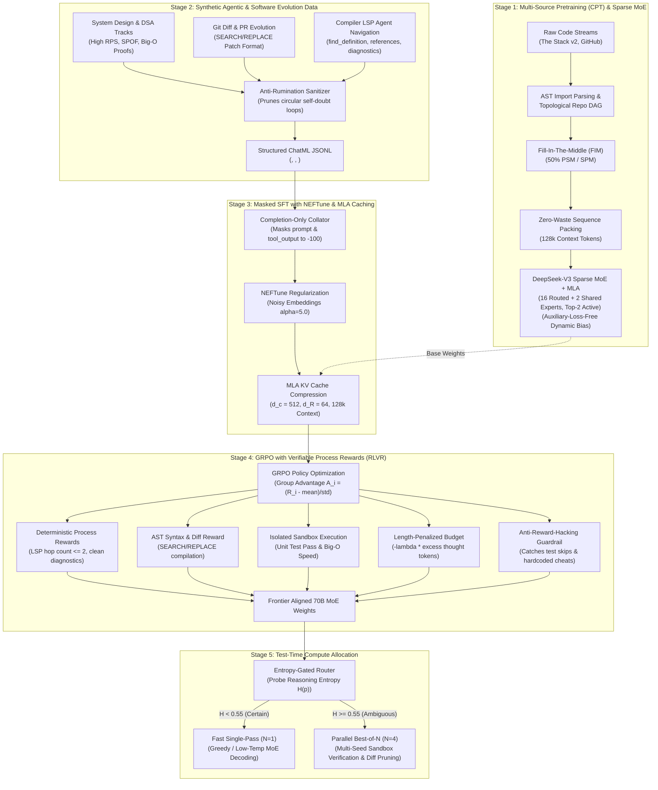

# 🍫 Cadbury-Chocolate 70B Frontier V2 — Sparse MoE, MLA & Verifiable Test-Time Compute

A complete, production-grade distributed training architecture, synthetic reasoning pipeline, compiler-LSP agent framework, and deterministic reinforcement learning system for a **70-Billion parameter code-generation & reasoning language model**. 

Modeled after frontier engineering breakthroughs: **DeepSeek-V3 / DeepSeek-Coder-V2**, **Claude 3.5 Sonnet / Opus**, and **OpenAI o1 / DeepSeek-R1**.

---

## 🏗️ 5-Stage End-to-End Frontier Architecture



---

## 🏛️ Model Architecture & Mathematics (Frontier V2)

| Hyperparameter | Value | Architectural Purpose |
| :--- | :--- | :--- |
| **Total Parameters** | **~70.55 Billion** | Deep reasoning across system architecture, algorithms, and 80+ programming languages |
| **Active Parameters / Token** | **~14.2 Billion** | Fine-grained **16 Routed Experts + 2 Shared Experts (Top-2 Active)** |
| **Layers (`n_layer`)** | **80** | Deep hierarchical abstraction of program logic, dataflow, and syntax |
| **Hidden Dimension (`d_model`)** | **8,192** | Wide residual stream representation space |
| **Attention Architecture** | **Multi-Head Latent Attention (MLA)** | DeepSeek-V3 style low-rank KV compression |
| **KV Compression Dim ($d_c$)** | **512** | Key-Value down-projection reducing KV cache by ~90% |
| **Decoupled RoPE Dim ($d_R$)** | **64** | Position keys decoupled from KV cache, avoiding cache expansion |
| **Number of Heads** | **64** | Attention heads (head dimension = 128) |
| **Expert Intermediate Size** | **4,096** | Fine-grained expert width for specialized algorithmic/domain routing |
| **Load Balancing Mechanism** | **Auxiliary-Loss-Free** | Dynamic expert bias $b_i \leftarrow b_i - \gamma \text{sign}(\text{load}_i - \bar{\text{load}})$ |
| **Context Window** | **131,072 tokens (128k)** | Full repository context enabled by MLA KV cache compression |
| **Vocabulary Size** | **128,270** | Byte-Level BPE with specialized `<think>`, `<hypothesis>`, `<tool_call>`, FIM tags |
| **Position Embeddings** | **RoPE ($\theta = 500,000$)** | High base frequency for long-context extrapolation |

---

## 💾 Multi-Head Latent Attention (MLA) vs GQA Memory Math

Traditional Multi-Head Attention (MHA) and Grouped-Query Attention (GQA) store full-rank Key and Value vectors in GPU VRAM for every token in the context window. At 128k context, this exhausts H100 VRAM.

### KV Cache Memory Per Token Equation:
$$\text{Memory}_{\text{MHA}} = 2 \times n_{\text{layers}} \times n_{\text{heads}} \times d_{\text{head}} \times 2\text{ bytes}$$
$$\text{Memory}_{\text{MLA}} = (d_c + d_R) \times n_{\text{layers}} \times 2\text{ bytes}$$

| Attention Mechanism | Dimension per Token / Layer | 32k Context KV Cache (80 Layers) | 128k Context KV Cache (80 Layers) | VRAM Reduction |
| :--- | :--- | :--- | :--- | :--- |
| **Standard MHA (64 heads)** | $2 \times 64 \times 128 = \mathbf{16,384\text{ floats}}$ | $\approx \mathbf{84.0\text{ GB}}$ | $\approx \mathbf{336.0\text{ GB}}$ *(OOM on 80GB GPU)* | Baseline ($1.0\times$) |
| **GQA (8 KV heads)** | $2 \times 8 \times 128 = \mathbf{2,048\text{ floats}}$ | $\approx \mathbf{10.5\text{ GB}}$ | $\approx \mathbf{42.0\text{ GB}}$ | $8.0\times$ smaller |
| **Cadbury MLA ($d_c=512, d_R=64$)** | $512 + 64 = \mathbf{576\text{ floats}}$ | $\approx \mathbf{2.9\text{ GB}}$ | $\approx \mathbf{11.8\text{ GB}}$ | **$\approx 28.4\times$ smaller ($\approx 90\%$ vs GQA)** |

Thanks to MLA, Cadbury-70B can maintain a full **128,000 token context window** during inference while reserving over 85% of GPU memory for weights and activations.

---

## ⚖️ Auxiliary-Loss-Free Load Balancing

Traditional MoE routers use an auxiliary balance loss ($\mathcal{L}_{\text{aux}} = \alpha \sum f_i P_i$) added to the main training loss. This forces the router to route tokens suboptimal for code generation just to balance GPU load, directly damaging code perplexity.

Cadbury-70B Frontier V2 implements **Auxiliary-Loss-Free Balancing**:
1. Token routing logits are computed as:
   $$s_{i,t} = \text{Top2}\left( \text{Softmax}\left( W_r \cdot x_t + b_i \right) \right)$$
2. An autonomous dynamic bias vector $b_i$ is maintained and updated after each forward pass without gradient backpropagation:
   $$b_i \leftarrow b_i - \gamma \cdot \text{sign}\left( \text{load}_i - \bar{\text{load}} \right)$$
3. If expert $i$ is overloaded ($\text{load}_i > \bar{\text{load}}$), its bias is decremented, gently shifting boundary tokens to under-utilized experts without perturbing the model's language gradients.

---

## 🛠️ Compiler & Language Server Protocol (LSP) Tools

To eliminate junior agent behaviors (e.g. dumping entire files or running recursive grep searches), Cadbury-70B is trained on compiler-grade LSP agent tools (`data_synthesis/lsp_tools.py`):

1. **`lsp_find_definition(symbol, context_file, line, character)`:** Jumps directly to symbol declaration across project repositories without grepping.
2. **`lsp_find_references(symbol, file_path)`:** Identifies all downstream consumers before modifying code to prevent breaking changes.
3. **`lsp_get_type_signature(symbol, file_path)`:** Retrieves AST type signatures, function parameter definitions, and return contracts.
4. **`lsp_get_diagnostics(file_path)`:** Runs linter, syntax checker, and compiler error diagnostics to verify patch validity.

---

## ✂️ Git Diff & PR Evolution Pipeline (`SEARCH/REPLACE`)

Cadbury-70B replaces full-file rewriting with surgical Git hunks (`data_processing/git_diff_pipeline.py`). Training data converts GitHub commits and pull requests into strict `SEARCH/REPLACE` blocks:

```text
# File: services/auth/jwt_validator.py
<<<<<<< SEARCH
def verify_token(token: str) -> bool:
    payload = jwt.decode(token, SECRET_KEY)
    return True
=======
def verify_token(token: str) -> bool:
    try:
        payload = jwt.decode(token, SECRET_KEY, algorithms=["HS256"])
        return payload.get("exp", 0) > time.time()
    except jwt.PyJWTError:
        return False
>>>>>>> REPLACE
```

---

## 🎯 Deterministic Verifiable Step Rewards (Correction #4)

Neural Process Reward Models (PRMs) are computationally expensive and prone to reward hacking (adversarial tokens triggering artificially inflated intermediate scores). Cadbury-70B replaces neural PRMs with **Deterministic Verifiable Step Rewards** in `training/rl_grpo_verifier.py`:

- **Surgical LSP Navigation Reward:** Rewarded ($+0.5$) when localizing bugs within $\le 2$ hops. Penalized ($-0.3$) for $>3$ unnecessary hops.
- **Syntactic Diff Verification:** Parses `SEARCH/REPLACE` blocks with Python AST; syntax errors receive a $-1.0$ penalty.
- **Diagnostic Cleanliness:** Using `lsp_get_diagnostics` to verify 0 syntax/linter errors receives a $+0.5$ bonus.
- **Functional Execution:** Unit test pass rates verified inside isolated execution sandboxes with strict time and memory bounds.

---

## ⚡ Entropy-Gated Best-of-N Test-Time Compute (Correction #5)

Running full Monte Carlo Tree Search (MCTS) or unconditional Best-of-N on every query introduces extreme latency and rumination on simple tasks. Cadbury-70B implements **Confidence-Gated Sandbox Routing** (`inference/test_time_router.py`):

1. **Entropy Probe:** During generation of the initial reasoning prefix, the router calculates predictive Shannon entropy:
   $$H(p) = -\sum_{v \in V} p(v) \log_2 p(v)$$
2. **Fast Single-Pass Path ($H < 0.55$):**
   - For straightforward syntax, algorithms, or boilerplate tasks, the model exhibits low entropy.
   - Routes immediately to single-pass greedy decoding ($N=1$). Zero latency overhead.
3. **Parallel Best-of-N Sandbox Search ($H \ge 0.55$):**
   - For ambiguous bugs, race conditions, or complex multi-file architectural refactors, entropy spikes.
   - Spawns $N=4$ parallel rollouts with exploratory sampling temperature ($\tau = 0.7$).
   - Evaluates each rollout against AST parsing and isolated unit test execution.
   - Selects the winning solution deterministically: **Passing unit tests > AST validity > Minimal diff footprint**.

---

## 📁 Repository Structure

```text
cadbury-chocolate/
├── configs/
│   ├── model_70b_config.yaml     # 70B MoE (16 routed, 2 shared) + MLA (d_c=512, d_R=64) + 128k context
│   ├── fsdp_config.yaml          # PyTorch FSDP FULL_SHARD cluster setup
│   ├── deepspeed_zero3.json      # DeepSpeed ZeRO-3 offload configuration
│   └── qlora_config.yaml         # 4-bit parameter-efficient fine-tuning config
├── data_collection/
│   ├── stream_hf_code.py         # Disk-free streaming ingestion from Hugging Face
│   ├── github_crawler.py         # Multi-language Git repository harvester
│   └── fim_formatter.py          # Fill-In-The-Middle (PSM/SPM) transformations
├── data_processing/
│   ├── syntax_validator.py       # AST-based syntax checking (Python, JS, C, Rust)
│   ├── secret_scrubber.py        # PII, API tokens, and cryptographic key sanitizer
│   ├── minhash_dedup.py          # MinHash LSH near-deduplication (Jaccard similarity)
│   ├── quality_filter.py         # Line-length, entropy, and autogen heuristics
│   ├── repo_packer_fim.py        # Topological AST import sorting & repo multipacking
│   └── git_diff_pipeline.py      # SEARCH/REPLACE block parser & commit/PR evolution formatter
├── data_synthesis/
│   ├── schemas.py                # BayesianHypothesis, ChatML & XML schemas (<hypothesis>, <think>)
│   ├── generate_reasoning_traces.py # Surgical System Design, DSA, & Anti-Rumination ReAct generator
│   └── lsp_tools.py              # Compiler LSP tools (definition, references, diagnostics, types)
├── inference/
│   ├── __init__.py               # Inference module exports
│   └── test_time_router.py       # Confidence-Gated Best-of-N Sandbox Router (Correction #5)
├── model/
│   ├── __init__.py               # Model exports (MLA, MoE, Router, Cadbury70BMoEModel)
│   └── moe_mla_architecture.py   # Multi-Head Latent Attention & Sparse MoE PyTorch modules
├── tokenization/
│   ├── train_code_tokenizer.py   # Byte-Level BPE with special tags (<think>, <hypothesis>, <tool_call>)
│   └── sequence_packer.py        # Zero-waste constant-length multipacking (128k ctx)
├── training/
│   ├── adaptive_compute.py       # Multi-Token Prediction (MTP) & Entropy Early-Exit Gate
│   ├── pretrain_fsdp.py          # Multi-node FSDP pretrainer with FlashAttention-2
│   ├── sft_reasoning_trainer.py  # Completion-Only Masked SFT with NEFTune regularizer
│   ├── rl_grpo_verifier.py       # GRPO with Deterministic Verifiable Step Rewards
│   ├── train_qlora.py            # 4-bit QLoRA fine-tuning for 70B on 1x 80GB GPU
│   └── launch_slurm.sh           # HPC SLURM submission script (4 nodes x 8 GPUs)
├── utils/
│   ├── logger.py                 # Rank-aware distributed cluster logger
│   └── memory_tracker.py         # VRAM allocation and peak usage profiler
├── requirements.txt              # Production cluster dependencies
└── README.md
```

---

## 🚀 Execution & Verification Commands

### 1. Test Confidence-Gated Best-of-N Test-Time Compute Router
```bash
python inference/test_time_router.py
```

### 2. Verify MoE + Multi-Head Latent Attention (MLA) Architecture
```bash
python model/moe_mla_architecture.py
```

### 3. Verify Compiler LSP Agent Navigation Tools
```bash
python data_synthesis/lsp_tools.py
```

### 4. Verify Git Diff `SEARCH/REPLACE` Pipeline
```bash
python data_processing/git_diff_pipeline.py
```

### 5. Launch Multi-Node Masked SFT with NEFTune
```bash
torchrun \
    --nnodes=4 \
    --nproc_per_node=8 \
    --rdzv_id=cadbury_sft \
    --rdzv_backend=c10d \
    --rdzv_endpoint=master-node:29500 \
    training/sft_reasoning_trainer.py \
    --model-path "checkpoints/cadbury-70b-moe" \
    --data-file "data/processed/sft_reasoning/sample_reasoning_data.jsonl" \
    --neftune-alpha 5.0 \
    --max-seq-len 131072
```

### 6. Run GRPO with Deterministic Step Rewards
```bash
torchrun --nproc_per_node=8 training/rl_grpo_verifier.py
```

---

## 📜 License
MIT License. Built for advanced code reasoning research, autonomous software engineering agents, and high-performance cluster deployment.
