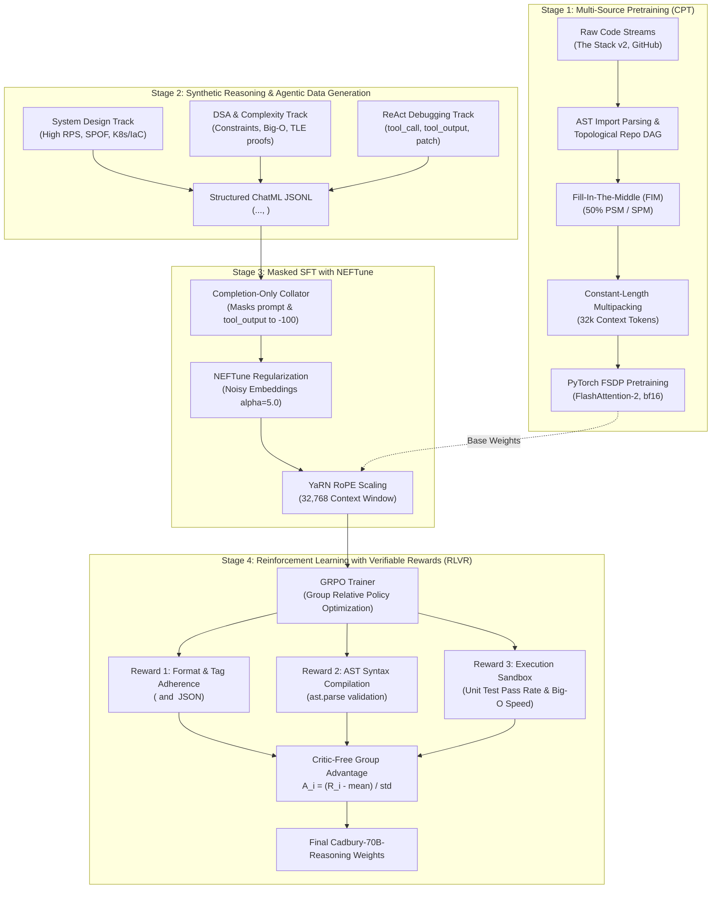

# 🍫 Cadbury-Chocolate 70B — Distributed Code Reasoning & Agentic LLM Pipeline

A complete, production-grade training architecture, synthetic reasoning pipeline, and execution-verified reinforcement learning framework for a **70-Billion parameter code-generation & reasoning language model**. 

Modeled after modern frontier architectures: **DeepSeek-R1 / DeepSeek-Coder-V2**, **Llama-3-70B**, and **StarCoder2**.

---

## 🏗️ 4-Stage End-to-End Training Architecture



---

## 🏛️ Model Architecture & Mathematics (70B)

| Hyperparameter | Value | Architectural Purpose |
| :--- | :--- | :--- |
| **Active Parameters** | **~70.55 Billion** | Deep reasoning across system architecture, algorithms, and 80+ languages |
| **Layers (`n_layer`)** | **80** | Deep hierarchical abstraction of program logic, dataflow, and syntax |
| **Hidden Dimension (`d_model`)** | **8,192** | Wide residual stream representation space |
| **Intermediate Size (`d_ff`)** | **28,672** | SwiGLU feed-forward layer (~3.5× hidden dimension) |
| **Attention Heads (`n_head`)** | **64** | Multi-head attention (Query dimension = 128) |
| **KV Heads (`num_kv_heads`)** | **8** | **Grouped-Query Attention (GQA)** (8:1 ratio) to save KV cache |
| **Context Window** | **32,768 tokens** | Full repository context via **YaRN RoPE Scaling** (factor 4.0) |
| **Vocabulary Size** | **128,268** | Byte-Level BPE with specialized `<think>`, `<tool_call>`, FIM tags |
| **Position Embeddings** | **RoPE ($\theta = 500,000$)** | High base frequency for long-context extrapolation |
| **Attention Kernel** | **FlashAttention-2** | Hardware-fused $O(N)$ memory attention |

### Parameter Count Derivation
1. **Self-Attention per layer:**
   * $W_q: 8192 \times 8192 = 67,108,864$
   * $W_k: 8192 \times 1024 = 8,388,608$ (GQA 8 heads $\times$ 128 dim)
   * $W_v: 8192 \times 1024 = 8,388,608$
   * $W_o: 8192 \times 8192 = 67,108,864$
   * *Subtotal Attention:* $\approx 150.99\text{ Million params/layer}$

2. **SwiGLU MLP per layer:**
   * $W_{gate}, W_{up}, W_{down}: 3 \times (8192 \times 28672) = 704,643,072$
   * *Subtotal MLP:* $\approx 704.64\text{ Million params/layer}$

3. **Total 80 Transformer Blocks:**
   * $80 \times (150.99\text{M} + 704.64\text{M}) = \mathbf{68.45\text{ Billion parameters}}$

4. **Embeddings & Output Head:**
   * $128,268 \text{ vocab} \times 8,192 \text{ hidden} \times 2 = \mathbf{2.10\text{ Billion parameters}}$
   * **Total Model Parameters: $\approx \mathbf{70.55\text{ Billion}}$**

---

## ⚡ Cluster Hardware & VRAM Memory Math

* **Model Weights (in bfloat16):** $70.55\text{B} \times 2\text{ bytes} \approx \mathbf{141.1\text{ GB}}$
* **Gradients (in bfloat16):** $70.55\text{B} \times 2\text{ bytes} \approx \mathbf{141.1\text{ GB}}$
* **AdamW Optimizer States (fp32 master weights, momentum, variance):** $70.55\text{B} \times 8\text{ bytes} \approx \mathbf{564.4\text{ GB}}$
* **Total Static Pretraining Footprint:** $\approx \mathbf{846.6\text{ GB}}$

### Cluster Feasibility Matrix

| Setup | Hardware | Method | Memory per GPU | Target Phase |
| :--- | :--- | :--- | :--- | :--- |
| **Multi-Node Cluster** | **32x H100 (80GB)** (4 Nodes) | PyTorch FSDP FULL_SHARD | $\approx 26.5\text{ GB}$ static + activations | Stage 1 CPT & Stage 3 SFT |
| **Mid-Scale Cluster** | **16x A100 (80GB)** (2 Nodes) | FSDP + Act. Checkpointing | $\approx 53.0\text{ GB}$ static + activations | Stage 3 SFT & Stage 4 GRPO |
| **Single GPU Developer** | **1x A100 / H100 (80GB)** | 4-bit NF4 QLoRA + Paged AdamW | $\approx 45.0\text{ GB}$ total VRAM | Single-Node Fine-Tuning |

---

## 📁 Repository Structure

```text
cadbury-chocolate/
├── configs/
│   ├── model_70b_config.yaml     # 70.55B architecture + YaRN RoPE (32k context)
│   ├── fsdp_config.yaml          # PyTorch FSDP FULL_SHARD cluster setup
│   ├── deepspeed_zero3.json      # DeepSpeed ZeRO-3 offload configuration
│   └── qlora_config.yaml         # 4-bit parameter-efficient fine-tuning config
├── data_collection/
│   ├── stream_hf_code.py         # Disk-free streaming ingestion from Hugging Face
│   ├── github_crawler.py         # Multi-language Git repository harvester
│   └── fim_formatter.py          # Fill-In-The-Middle (PSM/SPM) transformations
├── data_processing/
│   ├── syntax_validator.py       # AST-based syntax checking (Python, JS, C, Rust)
│   ├── secret_scrubber.py        # PII, API tokens, and cryptographic key sanitizer
│   ├── minhash_dedup.py          # MinHash LSH near-deduplication (Jaccard similarity)
│   ├── quality_filter.py         # Line-length, entropy, and autogen heuristics
│   └── repo_packer_fim.py        # Topological AST import sorting & repo multipacking
├── data_synthesis/
│   ├── schemas.py                # ChatML & XML schemas (<think>, <tool_call>, <tool_output>)
│   └── generate_reasoning_traces.py # System Design, DSA, & ReAct agent data generator
├── tokenization/
│   ├── train_code_tokenizer.py   # Byte-Level BPE with special tags (<think>, <tool_call>)
│   └── sequence_packer.py        # Zero-waste constant-length multipacking (32k ctx)
├── training/
│   ├── pretrain_fsdp.py          # Multi-node FSDP pretrainer with FlashAttention-2
│   ├── sft_reasoning_trainer.py  # Completion-Only Masked SFT with NEFTune regularizer
│   ├── rl_grpo_verifier.py       # DeepSeek-R1 style GRPO with 3 verifiable reward functions
│   ├── train_qlora.py            # 4-bit QLoRA fine-tuning for 70B on 1x 80GB GPU
│   └── launch_slurm.sh           # HPC SLURM submission script (4 nodes x 8 GPUs)
├── utils/
│   ├── logger.py                 # Rank-aware distributed cluster logger
│   └── memory_tracker.py         # VRAM allocation and peak usage profiler
├── requirements.txt              # Production cluster dependencies
└── README.md
```

---

## 🔬 Core Methodologies Explained

### 1. Repository-Level Topological Sorting (`repo_packer_fim.py`)
Code files are not independent documents. If a model encounters a service calling `User.find_by_id()` before it has seen `class User` in context, it must guess types and signatures.
* **AST Parsing:** Parses all intra-repository imports (`from models.user import User`).
* **Directed Acyclic Graph (DAG):** Resolves dependency order using `networkx.topological_sort`.
* **Result:** Fundamental data structures and interfaces appear *early* in the 32k context, enabling attention heads to attend backwards to exact class definitions.

### 2. Completion-Only SFT Masking (`sft_reasoning_trainer.py`)
Standard fine-tuning computes loss on both user prompts and assistant completions. In reasoning & tool trajectories:
* We **MUST NOT** train the model to predict user questions or environment `<tool_output>` strings.
* The custom collator dynamically sets all prompt and tool output tokens to label `-100`.
* Gradients are strictly computed on:
  $$\mathcal{L} = \mathcal{L}_{\text{thought}} + \mathcal{L}_{\text{tool\_call}} + \mathcal{L}_{\text{code}}$$

### 3. NEFTune Regularization (`NEFTuneHook`)
Synthetic reasoning traces have repetitive rhetorical boilerplate (*"Let me analyze the problem..."*). This can lead to overfitting:
$$\mathbf{e}' = \mathbf{e} + \boldsymbol{\epsilon}, \quad \boldsymbol{\epsilon} \sim \text{Uniform}(-1, 1) \times \frac{\alpha}{\sqrt{L \cdot d}}$$
Injecting uniform noise with $\alpha = 5.0$ into embeddings forces the model to generalize underlying logic rather than memorizing synthetic template phrases.

### 4. GRPO with Verifiable Rewards (`rl_grpo_verifier.py`)
Instead of training an unstable Neural Reward Model, **code can be verified deterministically**:
1. **Format Reward:** Enforces valid `<think>...</think>` XML blocks and valid JSON tool call arguments.
2. **AST Syntax Reward:** Parses code with Python's AST compiler. Invalid syntax receives $-1.0$.
3. **Execution Sandbox Reward:** Executes code against test suites in an isolated subprocess with timeout thresholds.
   * Tests pass: $+2.0$
   * Optimal speed ($<200$ms): $+0.5$ bonus
   * Time limit exceeded (TLE, $O(N^2)$ algorithm): $-1.5$ penalty

---

## 🚀 Cluster Execution Commands

### 1. Generate Synthetic Reasoning Trajectories
```bash
python data_synthesis/generate_reasoning_traces.py
```

### 2. Pack Repositories with Topological Sorting & FIM
```bash
python data_processing/repo_packer_fim.py
```

### 3. Launch Masked SFT with NEFTune across Multi-Node Cluster
```bash
torchrun \
    --nnodes=4 \
    --nproc_per_node=8 \
    --rdzv_id=cadbury_sft \
    --rdzv_backend=c10d \
    --rdzv_endpoint=master-node:29500 \
    training/sft_reasoning_trainer.py \
    --model-path "checkpoints/cadbury-70b" \
    --data-file "data/processed/sft_reasoning/sample_reasoning_data.jsonl" \
    --neftune-alpha 5.0 \
    --max-seq-len 32768
```

### 4. Run Group Relative Policy Optimization (GRPO)
```bash
torchrun --nproc_per_node=8 training/rl_grpo_verifier.py
```

---

## 📜 License
MIT License. Built for advanced code reasoning research, autonomous software engineering agents, and cluster deployment.
